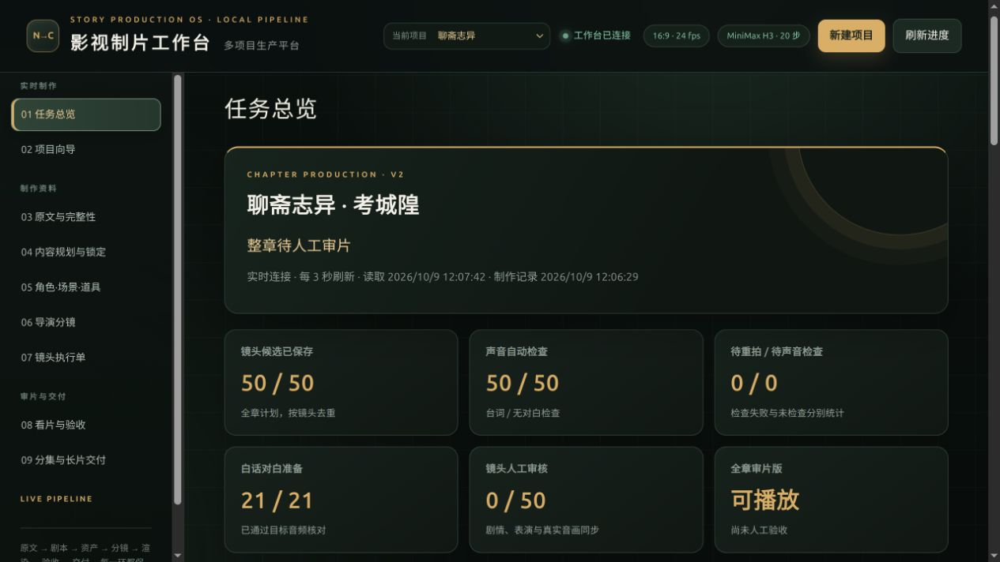

# Novel H3 Studio

一个面向小说逐章真人影视化的本地制片工作台。每本小说建立独立项目，保留完整原文、角色资产、白话剧本、影视化剧本、拍摄计划、H3 原生音画候选、剪辑时间线和审片证据。当前 v2 主线是“原文事实与改编 → 剧本影视化 → 角色与对白准备 → 镜头拍摄 → 声音复核与定点重拍 → 剪辑与文字合成 → 整章人工审片”。

系统负责可恢复的制作和证据记录；“镜头已生成”“声音自动检查通过”和“影视质量已人工验收”分别统计。剧情、表演、连贯性、口型和最终混音需要实际看片，不能由生成成功、ASR 或技术 QC 代替。

## 当前工作流与实现范围

所有后续章节都须遵循[故事连贯性与完整性规则](.cursor/rules/story-completeness.mdc)：整篇原文先读完，开场、关键因果、人物选择、代价和结尾必须落实到影片。新章节生成前需要 `narrative_contract.json`；`novel_h3.v2.narrative.preflight` 检查源事实及其具体交付，剪辑后再核对关键内容未被删除。结构检查通过仍不代表真实观众理解或影视质量人审通过。

- **MiniMax H3 原生音画**：v2 编译器明确绑定 Ref2VA 的人物、场景、道具和参考声线，不继承旧镜头 latent。当前《考城隍》使用 20 步、1376×768、24 fps；参数来自项目配置，不代表所有机器或章节的通用质量保证。
- **白话对白驱动表演**：对白目标音频覆盖完整生成时长，先核对原音和 H3 音频 VAE 重建，再作为 H3 采样条件。最终保留 H3 输出的原生音轨，不把被否定的镜头直接替换成后配 TTS。默认没有背景音乐。
- **剧本影视化**：参考 ViMax 的场景与动作节拍交接，在已有改编稿与拍摄之间保存独立影视剧本。每场有目标、阻力、转折、后果与承接；每镜绑定原文、动作首尾、轴线、屏幕方向和观众能看见或听见的转场。制作入口要求这份剧本，编译和剪辑核对其哈希及实际动作/对白，连续动作不能重置状态或反转轴线。结构检查不代表真实成片连贯或观众已理解。
- **素材只读与明确选择**：保存输入、模型、图片、音频、视频的哈希与 Comfy prompt ID。缓存复用核对实际创作依赖；定点重拍保留旧候选，剪辑按明确选择取片，不按文件名自动选最新版本。
- **声音与影视质量分开**：VAD、ASR、带声调读音核对是自动筛查；时间窗匹配不等于真实口型同步。无法评估的同步项目保留 `not_evaluated`。分析从实际用于剪辑、哈希匹配的原生 FLAC 母版生成 16 kHz 单声道代理，原生视频和音频母版保留；分析记录同时绑定视频和母版哈希。
- **按实际帧剪辑**：生成片段与剪辑镜头分离，时间线使用 24 fps 整数帧，支持明确的视频/音频来源与入出点。准确的中文试题、卷文、时间提示由字体排版合成，不依赖生成模型书写。
- **实时工作台**：每 3 秒读取新版制作记录，显示七阶段流程、全章镜头台账、独立重拍批次、对白准备、声音检查、导出阶段和进程存活情况。影视化稿和检查记录可直接打开。整章审片版导出后自动显示播放器；刷新不会重建正在播放的视频。
- **独立项目与兼容旧流程**：原文、资产、剧本和视频都保存在 `projects/<project-id>/`。旧项目保留原队列和素材；有 `production_v2/*/progress.json` 的项目显示新版工作台，不把旧版镜头混入新版计数。

通用的 v2 镜头编译、恢复运行、只读筛查和剪辑模块已经实现。`produce_cinema_chapter.py` 与 `repair_chapter_sound.py` 当前是《考城隍》的项目制作入口，依赖该项目已经准备的剧本、资产、对白环境和剪辑方案；它们不是上传任意小说后自动完成全书的通用入口。v2 审片页当前提供进度与播放，最终人工审批和逐章推进不能直接套用旧队列的自动通过状态。

影视化交接通过 `prepare_cinematic_chapter.py` 操作，输出必须放在新的制作修订目录，保留输入剧本。先执行 `prepare --project <项目绝对路径> --source-plan <已有计划绝对路径> --directory <新修订绝对路径>`，完整阅读生成的 `cinematization_request.json`，由当前 Codex 对话编排带场景与动作承接的新版计划，按请求格式保存 JSON；再执行 `accept --project <项目绝对路径> --directory <新修订绝对路径> --response <响应绝对路径>`。同步准备新版 `narrative_contract.json`、`editorial_blueprint.json` 后运行制作入口。`validate` 可再次核对源稿与影视化绑定。该阶段使用当前对话创作，不隐式调用另收费的模型 API，也不自动宣称人工验收。

2026-10-09 的本地运行快照：《考城隍》50 个候选已保存、50 个声音自动检查通过，约 240.29 秒的整章审片版已导出，影视质量仍待人工验收。项目素材和该审片版不在 Git 仓库中。



截图是制作快照，实际进度以当前服务读取的项目文件为准。[2026-10-08 的工作流审计与重构方案](docs/liaozhai-v2/README.md)包含后续设计项，不能把方案中的 SQLite、自动人审闭环等全部视为已实现功能。

## 从 Mac 或其他电脑访问

服务器上的 `127.0.0.1:8765` 只属于服务器。Mac 通过 Codex 远程连接到服务器时，应打开配置好的 HTTPS 网关地址，不要打开服务器的 `file:///.../web.html` 或把服务器 localhost 当作 Mac localhost。

运行 [`scripts/install_public_access.sh`](scripts/install_public_access.sh)可安装密码保护网关，并在 Tailscale 已登录、Funnel 已启用时生成固定 HTTPS 地址。浏览器现在通过 `/login` 网页表单登录，使用现有工作台账号密码；成功后获得最长 8 小时的受保护会话。API、项目文件和视频仍需认证，原有 Basic API 客户端保持兼容。

地址保存在 `runtime/public-progress-address.txt`，登录凭据保存在 `runtime/public-workbench-credentials.json`。这两个文件及全部项目数据不提交到 GitHub。远程配置与排错见 [`docs/public-access.md`](docs/public-access.md)。

## 已验证的本地运行环境

下面是本仓库在开发机上真实运行过的环境，其他机器可以使用相同的大版本；GPU 显存越小，越需要降低分辨率、帧数或启用更积极的卸载。

| 项目 | 开发机实测值 |
| --- | --- |
| 操作系统 | Ubuntu Linux x86_64，内核 7.0.0-31-generic |
| Python | 3.13.13（项目要求 Python 3.11 或更高） |
| GPU | NVIDIA GeForce RTX 5090，32,607 MiB 显存 |
| NVIDIA 驱动 | 595.91.07 |
| PyTorch | 2.13.0+cu130 |
| CUDA | 13.0，`torch.cuda.is_available()` 为 `True` |
| ComfyUI | 独立目录 `/home/jx/codes/comfyui-minimax-h3`，专用端口 8191 |
| 工作台 | Python 标准库服务，默认端口 8765 |
| v2 实测视频参数 | 1376×768，24 fps；审片导出保持原生画幅 |
| v2 当前章节 | MiniMax H3 原生 Ref2VA，20 步；旧队列保留 VDN-H3 Turbo 8 步路径 |

本仓库不上传大模型、小说正文、生成视频、音频、运行日志或项目状态。它们由下面的步骤在本机准备，并被 `.gitignore` 排除。

## 一、安装系统依赖

### 1. 基础工具

```bash
sudo apt-get update
sudo apt-get install -y git ffmpeg python3 python3-venv python3-pip
```

确认版本：

```bash
python3 --version          # 3.11 或更高
ffmpeg -version
nvidia-smi                 # NVIDIA 驱动和显卡应能被看到
```

### 2. 安装工作台

```bash
git clone https://github.com/jx1100370217/novel-h3-studio.git
cd novel-h3-studio
python3 -m venv .venv
. .venv/bin/activate
python -m pip install -U pip
python -m pip install -e .
```

工作台基础依赖是 `websocket-client`、NumPy 和 Python 标准库。视频推理依赖 ComfyUI 的独立环境，音频审片依赖 `.venv-audio`。v2 的联系表、文字合成、音频处理和对白读音核对另外使用 OpenCV、Pillow、SoundFile、pypinyin，可在相应环境执行 `python -m pip install -e ".[cinema]"`。安装包包含新版工作台所需的 JS/CSS。

## 二、安装 ComfyUI 和固定扩展

推荐把 ComfyUI 放在工作台外部，避免升级工作台时碰到模型目录：

```bash
export COMFY_ROOT=/home/jx/codes/comfyui-minimax-h3
git clone https://github.com/comfyanonymous/ComfyUI.git "$COMFY_ROOT"
cd "$COMFY_ROOT"
python3 -m venv .venv
. .venv/bin/activate
python -m pip install -U pip
# 按当前 GPU / CUDA 版本安装官方 PyTorch，再安装 ComfyUI 依赖
python -m pip install -r requirements.txt
cd /home/jx/codes/novel-h3-studio
```

> 如果机器上已经有可运行的 ComfyUI，只需把 `COMFY_ROOT` 改成现有目录，不要重复安装。`start_comfy.py` 会使用 `$COMFY_ROOT/.venv/bin/python`，并只挂载本项目固定的扩展。

下载并固定本项目使用的扩展：

```bash
python3 fetch_vendor.py
```

固定版本记录在 [`upstream.json`](upstream.json)：

- [ComfyUI-H3-Motion-Context](https://github.com/NikoDemon80/ComfyUI-H3-Motion-Context)：`5335715abe54c1a9bfbe3494da29aae3e8635ce3`。
- [ComfyUI-VDN-H3](https://github.com/Saganaki22/ComfyUI-VDN-H3)：v1.5.2，`3eb63496c24ca70faaf8a14b6c75fcb480e34bf1`。
- [ArcReel](https://github.com/ArcReel/ArcReel)：作为剧本/资产数据结构参考，不作为运行时依赖。

## 三、下载模型（大文件不进 Git）

所有模型都应放在本机模型目录或 Hugging Face 缓存中。下面的命令使用官方仓库和固定文件名；下载完成后运行 `doctor`，它会指出缺失的文件和实际搜索路径。

先安装 Hugging Face CLI，并在需要时登录：

```bash
python3 -m pip install -U "huggingface_hub[cli]"
# 公开模型无需登录；若账户受到限流或模型要求同意协议，再执行：
hf auth login
```

### 1. MiniMax H3 ComfyUI 基础权重（生产必需）

官方模型页：[Comfy-Org/MiniMax-H3](https://huggingface.co/Comfy-Org/MiniMax-H3)。本工作台默认使用 INT8 convrot 变体，适合显存有限的本地部署。下载到 ComfyUI 的对应目录：

```bash
export COMFY_ROOT=/home/jx/codes/comfyui-minimax-h3
mkdir -p "$COMFY_ROOT/models/diffusion_models" \
         "$COMFY_ROOT/models/text_encoders" \
         "$COMFY_ROOT/models/vae"

hf download Comfy-Org/MiniMax-H3 \
  diffusion_models/minimax_h3_fl2va_pruned_int8_convrot.safetensors \
  diffusion_models/minimax_h3_ref2va_pruned_int8_convrot.safetensors \
  text_encoders/qwen3vl_32b_minimax_h3_nvfp4_awq.safetensors \
  vae/minimax_h3_audio_vae_fp32.safetensors \
  vae/minimax_h3_video_vae_fp16.safetensors \
  --local-dir "$COMFY_ROOT/models"
```

当前配置使用的文件清单：

| ComfyUI 目录 | 文件 | 用途 |
| --- | --- | --- |
| `models/diffusion_models` | `minimax_h3_fl2va_pruned_int8_convrot.safetensors` | 首帧/文本到视听视频的基础扩散模型 |
| `models/diffusion_models` | `minimax_h3_ref2va_pruned_int8_convrot.safetensors` | 参考图到视听视频 |
| `models/text_encoders` | `qwen3vl_32b_minimax_h3_nvfp4_awq.safetensors` | H3 文本/视觉编码 |
| `models/vae` | `minimax_h3_audio_vae_fp32.safetensors` | 音频 VAE |
| `models/vae` | `minimax_h3_video_vae_fp16.safetensors` | 视频 VAE |

如果你改用官方页提供的 `minimax_h3_video_vae_int8_convrot.safetensors`，需同时在项目 `config.json` 的 `models.video_vae` 改成该文件名，再运行 `python3 studio.py --project /absolute/project/ doctor`。不要只改文件名而不改配置。

原始模型页：[MiniMaxAI/MiniMax-H3](https://huggingface.co/MiniMaxAI/MiniMax-H3)。原始仓库体积非常大，普通本地生产不需要下载完整快照；优先使用上面的 Comfy-Org 打包版本。

### 2. VDN-H3 Turbo 权重（旧队列使用，可选）

VDN-H3 官方说明：[ComfyUI-VDN-H3](https://github.com/Saganaki22/ComfyUI-VDN-H3)，权重仓库：[vdn-minimax-h3-int8-convrot-comfyui](https://huggingface.co/drbaph/vdn-minimax-h3-int8-convrot-comfyui)。

```bash
mkdir -p "$COMFY_ROOT/models/vdn/vdn-minimax-h3-int8-convrot-comfyui"
hf download drbaph/vdn-minimax-h3-int8-convrot-comfyui \
  --local-dir "$COMFY_ROOT/models/vdn/vdn-minimax-h3-int8-convrot-comfyui"
```

项目配置中的 `vdn_checkpoint` 必须保持为：

```json
"vdn_checkpoint": "vdn-minimax-h3-int8-convrot-comfyui"
```

不要把 VDN 文件复制到 `models/diffusion_models`；VDN 节点会从 `models/vdn` 查找。

### 3. 图片资产模型

角色、场景、道具和分镜首尾帧统一使用 Codex 订阅的 ChatGPT Images 2.5 图片工具生成。该工具是订阅能力，不是本地可下载的权重；工具不暴露底层模型选择参数，因此工作台会保存真实图片回执和 `model_verified` 状态，但不会伪造“已验证为 Images 2.5”。回执不提供型号时，记录 `requested_model=ChatGPT Images 2.5`、`actual_model=unknown`、`model_verified=false`。没有符合要求的图片工具时保留待处理工作单。

### 4. 本地音频审片模型（v2 自动声音检查所需）

音频审片默认使用：

- [Silero VAD](https://github.com/snakers4/silero-vad)：先判断音轨中是否存在可验证的人声；无对白镜头没有人声时不调用 ASR，避免环境音被幻觉转写。
- [Whisper large-v3-turbo](https://huggingface.co/openai/whisper-large-v3-turbo)：对白转写。
- [AST AudioSet](https://huggingface.co/MIT/ast-finetuned-audioset-10-10-0.4593)：雷声、水声、脚步等环境声分类。
- [Qwen2.5-Omni-7B](https://huggingface.co/Qwen/Qwen2.5-Omni-7B)：复杂音频理解和转写冲突辅助判断。

安装独立环境：

```bash
cd /home/jx/codes/novel-h3-studio
python3 setup_audio.py
.venv-audio/bin/python -m pip install -e ".[cinema]"
```

`setup_audio.py` 会同时安装并预热 Silero VAD。视频复核链路固定为“VAD 人声门禁 → 中文对白转写 → 严格文本核对”；VAD 未检测到人声时保留 H3 的雷声、水声、风声等原始环境音，不显示伪造的“实际转写”，也不触发音频清洗。

如需预热指定版本，可执行：

```bash
hf download openai/whisper-large-v3-turbo \
  --revision 41f01f3fe87f28c78e2fbf8b568835947dd65ed9
hf download MIT/ast-finetuned-audioset-10-10-0.4593 \
  --revision f826b80d28226b62986cc218e5cec390b1096902
hf download Qwen/Qwen2.5-Omni-7B \
  --revision ae9e1690543ffd5c0221dc27f79834d0294cba00
```

v2 声音筛查依赖 Silero VAD 和 Whisper；AST 用于环境声分析，Qwen Omni 是可选的辅助复核。它们的自动输出都不等同最终人工听音。

本地命令：

```bash
/home/jx/codes/novel-h3-studio/listen_audio \
  /absolute/path/chapter_s0003.mp4 \
  --out /absolute/path/audio-review
```

首次分析约需要 18 GiB 可用显存。视频推理正在占用本项目显卡时，工作台会阻止并行音频分析，避免把显存打满。完整说明见 [`docs/本地音频理解.md`](docs/本地音频理解.md)。

#### 白话对白目标环境（全章制作入口需要）

当前全章入口使用独立 `.venv-dialogue`，本机验证过的组合是 `qwen-tts==0.1.1`、`transformers==4.57.3`、`accelerate==1.12.0` 和 PyTorch `2.11.0+cu130`。请按硬件平台准备这个独立环境，避免改动 ComfyUI 的推理环境。仅使用无目标音频的原生 H3 逐镜入口时，可以不安装该 TTS 环境。

对白目标脚本固定读取 `Qwen/Qwen3-TTS-12Hz-1.7B-Base` 的本地缓存，不在线自动下载。预先获取固定版本：

```bash
hf download Qwen/Qwen3-TTS-12Hz-1.7B-Base \
  --revision fd4b254389122332181a7c3db7f27e918eec64e3
```

默认缓存位于当前用户的 `~/.cache/huggingface/hub/`。自然语速的原始 WAV 先落盘，再仅补齐首尾静音作为 H3 输入；不加速、不截断对白，不把 TTS WAV 当作成片的后配音轨。参考音频必须已有审核、哈希和核对后的原始转写。

### 5. Blender 白模空间与运镜预演（旧队列可选）

旧队列可读取镜头绑定的场景、角色站位、对白说话人和运镜，使用 Blender 构建低多边形白模并渲染为无声 24 fps 引导片，再把引导片帧序列作为 H3 Ref2VA 的 `<Video 1>` 输入。H3 同时保留经审核的场景/人物图片和说话人参考音频：白模负责空间布局、人物数量与站位、屏幕方向和摄像机运动；成片写实外观仍由批准的图片资产决定。白模不会生成音轨，H3 接收的是渲染画面，不是 `.blend` 工程文件。

推荐安装 Blender 5.2.2 LTS 的便携版，不改系统 Python 或 ComfyUI 环境：

```bash
cd /home/jx/codes/novel-h3-studio
bash scripts/install_blender.sh
```

旧队列新项目默认启用白模预演；当前 v2 原生 Ref2VA 编译器不绑定白模 Video 参考。默认分辨率为 512×288，最多双线程，单个引导片不超过 15 秒；画面需要更多细节时可在项目 `config.json` 的 `blender_previs` 中调整。每个实际提交镜头会在 `previews/blender_previs/<章节>/<镜号>/` 留下可编辑 `.blend`、白模 MP4、首帧和哈希清单；实际送入 H3 的路径、时长、分辨率和参考槽记录在镜头执行单中。若 Blender 或 ComfyUI 核心 `LoadVideo` / `GetVideoComponents` 节点缺失，环境自检会明确报错，不会悄悄退回没有白模引导的生成。

白模是可见像素条件，不是精确几何锁；H3 仍可能改写建筑细节或运镜，所以交付前仍须检查空场、角色数量、机位轴线和相邻镜头的动作接点。已经完成的普通镜头成片保留；后续新生成和人工重拍镜头会使用白模引导。

### 6. FastH3-Omni NVFP4 QAD（FastVideo 原生路线）

FastH3 Omni 使用官方 `FastVideo/FastH3-Omni-NVFP4-QAD`，通过隔离的 FastVideo CUDA 13 环境和本机 `127.0.0.1:8195` 服务生成同步音画。原有 FastH3 Omni ComfyUI INT8 路线已移除。VDN-H3 Turbo 和基础 MiniMax H3 仍使用各自的 ComfyUI 路线。

安装组件和启动方法见 [FastH3-Omni 本地部署](docs/FastH3-Omni本地部署.md)。5090 使用固定 8 次 PDD 前向、NVFP4 线性层、FP4 视频稀疏注意力和 FP8 条件前缀、预计算 AdaLN 表、编码器卸载及 NVFP4 视频解码器。所有模型文件与运行时版本均记录在实际请求中。

完整章节入口：`produce_cinema_chapter.py PROJECT PLAN --seed SEED`。分镜须绑定完整原文、影视化稿、叙事交付及严格官方 Ref2VA 六段提示词；新的 FastVideo 请求不接受旧 ComfyUI 工作流。逐镜保留提示词、素材哈希、FastVideo 作业 ID、原生音画与检查结果，输出未通过人审的完整初剪。

### 7. FastH3-8-Step-V2（旧版隔离速度基准）

工作台保留的是 **FastH3-8-Step-V2 的 ComfyUI 兼容路径**，不包含官方 VSA-H3 runner。兼容权重由官方模型页转换为 ComfyUI 单文件格式，来源仍是 [FastVideo/FastVideo-FastH3-8-Step-V2](https://huggingface.co/FastVideo/FastVideo-FastH3-8-Step-V2)，可从 [FastVideo/FastVideo-FastH3-Comfy](https://huggingface.co/FastVideo/FastVideo-FastH3-Comfy) 获取。

下载 ComfyUI 基准需要的 INT8 ConvRot 视频模型：

```bash
hf download FastVideo/FastVideo-FastH3-Comfy \
  diffusion_models/fastvideo_fasth3_8step_v2_pruned_int8_convrot.safetensors \
  --local-dir "$COMFY_ROOT"
python3 scripts/run_fasth3_benchmark.py --help
```

它使用现有 ComfyUI 的 H3 文本编码器、音频 VAE、视频 VAE 和保存节点，只把视频扩散模型替换为 FastH3 兼容单文件；不改变生产配置、镜头指纹或已生成视频。基准结果写入项目的 `benchmarks/`，该目录属于生成数据，不上传 Git。详细说明见 [`docs/FastVideo基准接入.md`](docs/FastVideo基准接入.md)。

## 四、启动服务并做环境自检

先启动专用 ComfyUI：

```bash
cd /home/jx/codes/novel-h3-studio
python3 fetch_vendor.py
python3 start_comfy.py --project /absolute/project/path
```

它会使用 `COMFY_ROOT/.venv/bin/python`，监听 `127.0.0.1:8191`，并启用显存保护参数。另开终端启动工作台：

```bash
cd /home/jx/codes/novel-h3-studio
python3 studio.py --project /absolute/project/path serve --no-browser
```

与服务器在同一台机器时，浏览器打开 <http://127.0.0.1:8765>。远程客户端使用上文的 HTTPS 网关，登录后查看制作进度。

启动后先自检：

```bash
python3 studio.py --project /absolute/project/path doctor
```

`doctor` 按项目配置检查 ComfyUI、权重、所需节点、FFmpeg/FFprobe 和分辨率；旧队列启用 VDN 时还需其权重与节点。v2 编译器另外保存实际 H3 权重指纹并校验提交节点图。自检失败时不要点击视频生成，先按输出中的文件路径补齐。

## 五、v2 章节制作顺序

### 1. 建立独立项目与章节改编

工作台顶部点击 **新建项目** 上传 TXT，或执行：

```bash
python3 studio.py --project /absolute/projects/my-novel init /absolute/path/小说.txt
```

保留整本原文和物理顺序。前言、序文等资料段与正式故事区分，先选择一个章节，建立原文事实、因果关系、人物动机、分场剧本和白话对白。每个镜头要说明观众获得的信息、表演意图、动作起止、场景轴线、声音与剪辑用途；不能仅把原文切句后逐句拍成完整模型片段。

在项目内准备 `production_v2/<chapter-id>/`，保存 `story.json`、`screenplay.md`、章节计划和 `editorial_blueprint.json`。这些是创作输入，不会从 GitHub 自动下载。

### 2. 准备角色、场景与对白

通过原有 **角色·场景·道具** 页面登记参考图片、四视参考图、场景和关键道具，以及说话角色的参考音频。图片回执和来源校验继续保留。计划里的 `cast`、`scene_id`、`references`、`spoken_lines[].speaker` 使用资产 ID，模型引用序号由编译器统一分配。

每个 v2 生成片段当前只支持一个可见说话人；其他角色的反应另拍后剪入。单次生成时长为 4–15 秒，短剪辑镜头用实际帧的入出点获得，不把不支持的生成时长静默夹到下限。含对白的音频目标必须与登记说话人、白话原句一致，且覆盖 H3 帧网格对应的完整时长；无对白条件需要同一音频哈希对应的无语音检查证据。

对白准备先核对目标音频，再核对 H3 音频 VAE 重建，合格后作为采样条件。它不证明真人口型、表演或声线已人工通过。

### 3. 编译、生成与恢复候选

通用 v2 镜头入口需要一份已经完成资产绑定的计划：

```bash
.venv-audio/bin/python render_cinema.py   /absolute/projects/my-novel   /absolute/projects/my-novel/production_v2/chapter_s0002/chapter_plan.json   --shots P01 P02 --seed 2026100801
```

不指定 `--shots` 时执行该计划的全部镜头。运行前需要当前用户的 systemd 资源隔离配置、可用的 ComfyUI 与对应模型；所有 H3 任务串行执行，已有其他任务时拒绝重复提交。每镜保存请求、节点图、prompt ID、输入指纹、原生 MP4/FLAC、技术检查和声音报告。重启后核对相同请求与媒体哈希，再复用保存结果或恢复尚未完成的检查；提交结果不明时先对照 Comfy history，避免再提交一次。

当前《考城隍》的全章入口如下，依赖该本地项目已准备的资产、音频环境、P03 试拍和剪辑方案：

```bash
.venv-audio/bin/python produce_cinema_chapter.py   /absolute/projects/liaozhai-zhiyi   /absolute/projects/liaozhai-zhiyi/production_v2/chapter_s0002/chapter_plan.json
```

这个项目入口还使用 `.venv-dialogue` 中的本地 Qwen3-TTS Base 环境。对白制作代码位于 `scripts/prepare_dialogue_target.py` 和 `scripts/prepare_chapter_audio.py`，通过 `--project`、`--plan` 绑定本地创作数据；`--execute` 才会载入模型，默认仅检查输入。通用 runner 不会替用户编写剧本，也不会自动把全部章节投入制作。

### 4. 声音复核与定点重拍

声音报告核对实际输出和已锁定对白。v2 采用零差异正字或带声调的读音序列核对，不使用旧版整句别名来消除错词。无对白片段必须有 VAD 的可用、无语音证据。识别代理只供分析，不写回原生音轨；字幕、剧本和原文不会为通过检查而被改写。

修复目标、构图、人物数量或台词后产生新候选，保留旧候选和原因，明确更新选择。连续硬错误应回到上游修改，不能无限重拍。`repair_chapter_sound.py` 是《考城隍》三个已定位无对白镜头的恢复入口，不是通用的全部章节修复命令。

### 5. 剪辑与准确文字合成

`novel_h3.v2.chapter_edit.chapter_timeline` 将导演方案和明确的镜头选择转换为帧时间线。`novel_h3.v2.edit.export_review` 对原生视频、音频哈希重新核对，再按 `source_in_frame` / `source_out_frame` 剪辑，并支持明确的跨候选音频来源。原生素材不会因导出被覆盖。

中文试题、卷文和时间提示使用登记字体准确合成；字幕时间依据实际声音检测与所写时间线，仍需检查口型及可读性。默认保留原生声音，不对每镜单独拉满响度，也不添加 BGM。

输出包括：

```text
projects/<project-id>/production_v2/<chapter-id>/takes/<take-id>/native.mp4
projects/<project-id>/production_v2/<chapter-id>/takes/<take-id>/native_audio.flac
projects/<project-id>/production_v2/<chapter-id>/chapter_review_timeline.json
projects/<project-id>/review_exports/<version>/review.mp4
projects/<project-id>/review_exports/<version>/review.srt
projects/<project-id>/review_exports/<version>/manifest.json
```

### 6. 实时跟踪与整章人工审片

打开工作台 **任务总览** 或 **看片与验收**。新版轻量接口是 `GET /api/production-progress`，显示全章唯一镜头数、声音通过数、需重拍数、人工审核数、当前批次、工作进程状态和剪辑导出阶段。三镜重拍批次不会把整章总数改成三镜；制作进程退出或连接中断会明确显示。

全章导出并通过技术检查后，播放器自动出现。审片版保留 `release_approved=false`、`human_listened=false`，需要实际检查剧情因果、演员表演、镜头衔接、人物与道具一致性、白话对白、可见口型、音量及准确文字，然后再决定是否交付和推进下一章。

旧项目仍可以使用 `studio.py submit/sync/review-take/assemble-chapter` 等兼容命令；这些命令读取旧 `state.json`，不会自动审批或合成 `production_v2` 的候选。

## 六、旧队列 VDN-H3 速度记录（历史对比）

这是开发机 RTX 5090 上的真实生产配置对比，不是同一步数、同一算法的实验室基准。两组都使用同一台机器、同一套基础量化权重、相同镜头条件和 24 fps；VDN 使用 8 步 `er_sde / beta`，旧方案使用普通 H3 32 步 `res_multistep / simple`。计时从 ComfyUI `execution_start` 到 `execution_success`，包含模型准备、采样、解码和保存，不包含排队、图片生成、审片、重拍、合成和超分。

| 镜头 | 成片时长 | 普通 MiniMax H3 · 32 步 | VDN-H3 Turbo · 8 步 | 实测加速 |
| --- | ---: | ---: | ---: | ---: |
| 洪水首镜 | 5.167 秒 | 193.423 秒 | 69.546 秒 | 2.78× |
| 洪水续镜 | 5.667 秒 | 326.891 秒 | 95.805 秒 | 3.41× |
| 振明狩猎 | 5.167 秒 | 197.151 秒 | 68.160 秒 | 2.89× |
| **合计** | **16.000 秒** | **717.465 秒** | **233.511 秒** | **3.07×** |

这组结果说明 VDN-H3 Turbo 在当前本机配置下明显更快，但不能承诺所有镜头、冷启动和显存状态都保持同一倍数。第三条 VDN 任务曾在 4/8 步被服务 SIGTERM 中断，重启后才成功；中断本身不计入上表。完整原始数据、参数、权重指纹和限制见 [`docs/VDN-H3切换与实测.md`](docs/VDN-H3切换与实测.md) 和 [`docs/qa/vdn-speed-comparison.json`](docs/qa/vdn-speed-comparison.json)。

以下为旧队列的 VDN 实测配置，不是当前 v2 原生 H3 章节配置：

```text
ComfyUI: 127.0.0.1:8191
工作台:   127.0.0.1:8765
采样:     8 步，er_sde / beta，VDN Turbo
内部画布: 1376×768，交付 1366×768，24 fps
显存保护: 预留 4 GiB，关闭异步卸载和 pinned memory，单进程模型缓存
```

旧队列尽量复用模型缓存。v2 为控制连续生产内存，在完成镜头检查后按资源策略释放缓存；`--cache-ram 12 16` 是可用系统内存触发阈值，不能当成缓存大小。遇到加载缓慢应查看日志和 `doctor`，不要并行启动第二个视频 worker。

## 七、常用排错

### 工作台打不开

```bash
ss -ltnp | rg '8765|8766|8191'
python3 studio.py --project /absolute/project/path doctor
```

远程 Mac 的 `ERR_INVALID_AUTH_CREDENTIALS` 应检查网页登录入口；当前网关会跳转 `/login`，不再要求内置浏览器弹出 Basic 认证框。登录成功后才能读取 API 和视频。若仍看到旧错误页，重新加载或直接打开 HTTPS 地址的 `/login`。安装了持久服务时可运行：

```bash
systemctl --user restart novel-h3-public-workbench.service
systemctl --user restart novel-h3-workbench-persistent.service
journalctl --user -u novel-h3-public-workbench.service -n 50 --no-pager
```

确保工作台和 ComfyUI 都由当前代码启动。修改会影响服务端的 Python 文件后，先停止旧进程，再重新运行 `studio.py ... serve`；只刷新浏览器不会加载旧进程的新代码。

### 模型找不到

1. 检查 `config.json` 中的 `comfy_root` 和文件名。
2. 确认模型位于 `models/diffusion_models`、`models/text_encoders`、`models/vae`、`models/vdn` 的正确层级。
3. 重新执行 `python3 studio.py --project ... doctor`。
4. 查看 ComfyUI 启动日志，确认 Motion Context 和 VDN 节点没有被另一份 custom node 覆盖。

### 任务卡在加载或显存不足

- 一台机器只保留一个本项目 ComfyUI 8191 进程和一个视频 worker。
- 停止音频审片、FastVideo 基准和其他占用显卡的任务。
- 使用 1366×768 或更低分辨率，减少同时运行的任务；不要绕过 `GENERATION_PAUSED` 保护。
- 确认 `nvidia-smi` 中显存、温度和功耗正常；服务异常退出后先查看日志再重试。

### 转写失败或出现异常人声

先确认锁定台词、说话人、参考音频与完整时长的音频目标，再检查 H3 实际输出。v2 只读检查原生音画，出现错词或额外人声时回到目标音频、构图或生成条件重拍，保留旧候选。旧项目的清理路径不能当成新版原生素材的默认修复步骤。

### 合成的视频缺章节

旧队列按其验收记录合成章节；v2 则在候选技术和声音检查后先导出明确标记的审片版，仍待影视质量人审。旧队列可检查：

```bash
python3 studio.py --project /absolute/project/path coverage
python3 studio.py --project /absolute/project/path status
```

不要把“镜头已生成”误认为“章节已交付”；必须完成审片和章节合成。

## 八、代码和数据边界

提交到 GitHub 的内容包括工作台代码、固定版本记录、示例、测试、文档和模型获取说明。以下内容明确不上传：

- `projects/`：小说原文、角色图片、参考音频、剧本、镜头和视频。
- `runtime/`：队列状态、日志、ComfyUI 数据库、临时文件和本机凭据。
- `vendor/`：上游扩展的本地 checkout；用 `fetch_vendor.py` 按 `upstream.json` 重建。
- `.venv/`、`.venv-audio/`、`.venv-dialogue/`、模型目录、Hugging Face 缓存、编译缓存和生成视频。
- 临时数据库（如 `:memory:.ses`）；文档可以提交经过检查的 UI 截图，不能包含密码、会话令牌或媒体母版。

许可证和上游声明见 [`LICENSE`](LICENSE) 与 [`NOTICE.md`](NOTICE.md)。使用 ArcReel、Motion Context 或 VDN-H3 时，还要遵守对应仓库的许可证和模型条款。

## 九、验证

在安装了基础及 cinema 依赖的环境中运行测试；FFmpeg、Blender 等实物检查需要对应本地程序，缺失的本地素材检查会明确跳过：

```bash
python -m pip install -e ".[cinema]"
python -m unittest discover -s tests -p 'test_*.py' -q
node --check novel_h3/cinema_dashboard.js  # 可选：安装 Node.js 时检查前端语法
```

随后按实际配置运行 `studio.py --project ... doctor`，在真实浏览器验证项目、模型和制作记录。远程访问还应验证：未登录会进入网页登录；未登录 API/媒体仍受保护；登录后实时计数刷新、视频分段播放正常。声音检查通过不能写成人工影视验收。

## 十、代码结构

| 路径 | 作用 |
| --- | --- |
| `novel_h3/project.py` | 多项目目录、配置和状态 |
| `novel_h3/preparation.py` | 原文、章节、剧本、资产和准备门禁 |
| `novel_h3/director.py` | 分镜节奏、运镜、时长和提示词 |
| `novel_h3/shot_package.py` | 资产绑定镜头执行单和 H3 输入包 |
| `novel_h3/comfy.py` | ComfyUI 提交、恢复、取消、模型和媒体回写 |
| `novel_h3/audio_cleanup.py` | 异常人声检测与音频清理 |
| `novel_h3/media.py` | 技术检查、字幕、章节与全量合成 |
| `novel_h3/server.py` / `novel_h3/web.html` | 多项目工作台 API 与界面 |
| `novel_h3/cinema_dashboard.py` / `.js` / `.css` | v2 全章进度、重拍计数、导出与审片播放器 |
| `novel_h3/public_gateway.py` | 网页登录、受保护会话与媒体/API 代理 |
| `novel_h3/v2/` | H3 编译与恢复、声音条件、只读筛查、帧剪辑和准确文字 |
| `scripts/prepare_dialogue_target.py` / `prepare_chapter_audio.py` | 单镜与整章对白目标制作、自然语速补齐、保存与恢复 |
| `render_cinema.py` | 通用 v2 已编排镜头的生成入口 |
| `produce_cinema_chapter.py` / `repair_chapter_sound.py` | 当前《考城隍》全章制作与指定声音重拍入口 |
| `fetch_vendor.py` / `start_comfy.py` | 固定扩展获取与专用 ComfyUI 启动 |
| `docs/` | 制作规范、音频审片、VDN 实测和 FastVideo 隔离基准 |
| `tests/` | 工作流、UI、资产、音频、队列和安全测试 |

如果你只想先验证流程，可以用 `examples/` 中的最小示例创建项目；如果要制作真实长篇小说，请先完成原文完整性和资产登记，再启动视频队列。
