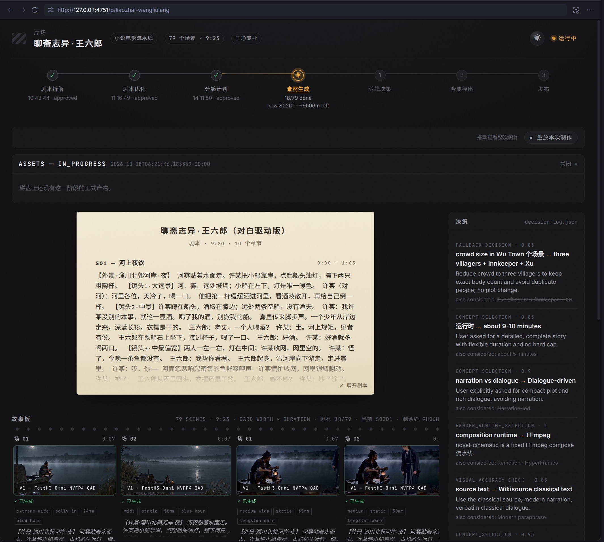
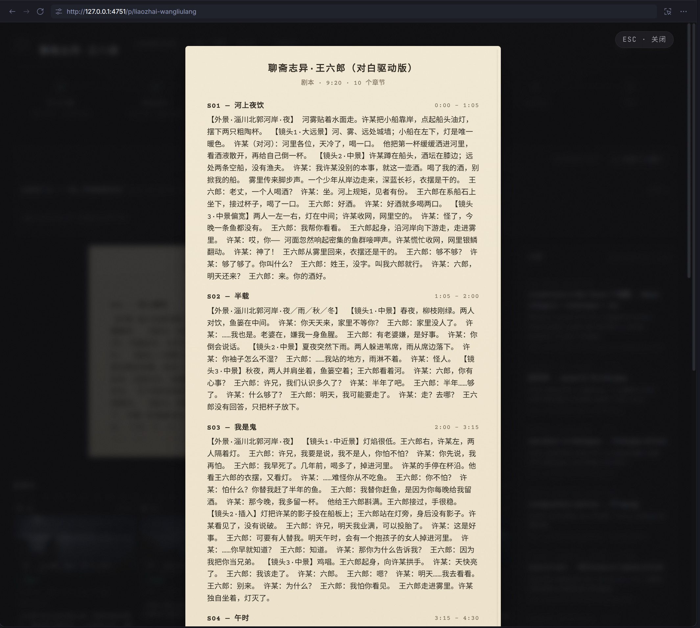
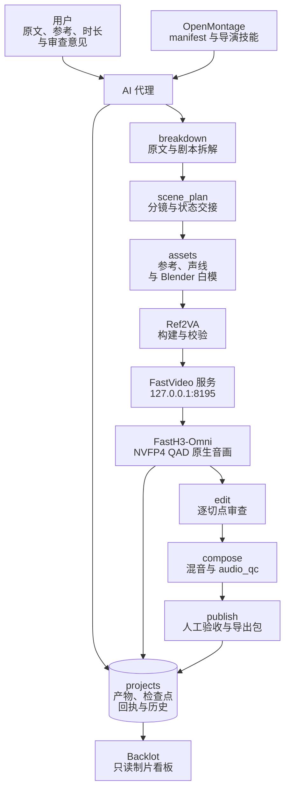

# Novel H3 Studio

**把小说原文、角色与场景参考，制作成可追溯、可续跑、可逐镜审查的影视章节。**

Novel H3 Studio 是以 **OpenMontage 为生产工作流、FastH3-Omni 为本地音画生成引擎、Backlot 为制片看板**的单仓库项目。小说拆解、剧本、分镜、人物声线、Blender 站位预演、视频生成、连续性检查、声音混合与交付审查，都围绕同一个项目目录组织。

默认路线为 **FastH3-Omni NVFP4 QAD → FastVideo HTTP 服务 → 严格 Ref2VA 单镜音画 → FFmpeg 剪辑与混音**，交付画布为 **1344 × 768、24 fps、H.264 / AAC**。角色对白和现场音效来自 H3 原生音轨，只有旁白使用 TTS。

> 本文按 2026-10-23 重构后的代码编写。统一入口为根目录 `studio.py`。旧网页工作台、旧 `novel-h3` CLI、`novel_h3.v2` 和旧全书自动生产脚本已移除；历史文档中的旧命令不能直接套用。

## 目录

- [1. 这个代码库解决什么问题](#purpose)
- [2. 工作流真实截图](#screenshots)
- [3. 架构与代码目录](#architecture)
- [4. 部署条件与安装范围](#requirements)
- [5. 安装工作流与启动看板](#workflow-install)
- [6. 获取模型与安装 FastVideo](#models)
- [7. 配置模型资源隔离](#resource-policy)
- [8. 配置并启动模型服务](#model-service)
- [9. 图片、声线、旁白和音乐](#references)
- [10. 从小说到成片的完整工作流](#production)
- [11. 分镜数据与 Ref2VA](#shot-contract)
- [12. 生成、续跑与版本管理](#rendering)
- [13. 衔接审查、合成与声音验收](#post-production)
- [14. Backlot、远程访问与备份](#backlot)
- [15. 可选 VDN / ComfyUI 路线](#vdn)
- [16. 命令速查与配置位置](#commands)
- [17. 验证与开发约定](#development)
- [18. 常见问题与当前边界](#troubleshooting)
- [19. 延伸阅读、上游与许可证](#credits)

<a id="purpose"></a>
## 1. 这个代码库解决什么问题

单次文生视频能得到一个片段，小说影视化还需要持续维护原文事实、人物形象、台词归属、空间关系、镜头衔接、音轨和修改记录。本项目围绕这些生产问题组织代码：

- **原文可追溯。** 剧本与分镜记录来源段落，保存源文件及哈希，区分原文、改编和制作决策。
- **参考资产复用。** 已审定的人物、服装和场景参考持续复用，避免每镜重新生成人脸。
- **精确可见演员。** 每镜明确出现哪些人、各身份对应几个身体；画外发声者不自动算作画面中的人。
- **声线绑定。** 每位说话角色有独立 WAV 参考，并绑定到自己的主体和对白。
- **多人空间预演。** 用 Blender 灰模图约束人数、站位、姿态和摄影机，最终外观仍来自正式参考图。
- **严格 Ref2VA。** 统一六段英文提示词、参考编号、说话顺序、对白时间和可见人数合同。
- **保留原生音画。** 每镜保存自带同步音频的 `native.mp4`，合成时保留对白与音效。
- **修改可追踪。** 请求、作业 ID、素材哈希、生成回执、检查点和历史版本落盘，支持定点重做。
- **生产过程可见。** Backlot 从真实项目文件读取剧本、故事板、当前镜头、阶段状态和决策。

适合本地小说影视化、古装短片、章节试制、同一角色的连续镜头，以及需要审查和迭代的长篇内容。

**制作由代理驱动。** OpenMontage 的 YAML manifest 规定步骤，阶段导演技能说明如何制作，Python 提供工具和状态存储。启动网页得到的是制片看板；真正推进制作，需要 AI 编码代理按阶段执行，或由开发者在相应阶段调用正式工具。

<a id="screenshots"></a>
## 2. 工作流真实截图

截图采集自本仓库实际运行的《聊斋志异·考城隍》项目，采集日期为 **2026-10-23**。示例项目有 45 个场景；图中的 V5 处于素材生成阶段，尚未作为最终成片验收。示例生产素材不随 Git 克隆。

### 制片总览：阶段、剧本、故事板和当前版本



上方是流水线阶段；左侧是剧本、镜头卡和渲染区域；右侧是决策与事件。新修订制作期间，看板区分当前版本镜头与上一版导出。

### 剧本审查：镜头编号、台词归属与时间窗口



截图展示界面能力与采集时的状态，不代表图中画面、台词和声音已经全部通过最终人工审查。看板的 `$0.00` 是已记录的生成费用，不包含硬件、电力、订阅和人工时间。

<a id="architecture"></a>
## 3. 架构与代码目录



```text
novel-h3-studio/
├── studio.py                         # init / board / serve / doctor / tool
├── start_fastvideo.py                # 单张 RTX 5090 的模型服务启动器
├── AGENTS.md                         # 生产合同与默认参数
├── novel_h3/                         # 本地后端与共享制作模块
│   ├── fastvideo.py                  # 模型配置、完整性、模型锁与 HTTP 请求翻译
│   ├── fastvideo_batch.py            # 单镜提交、轮询、下载、回执与缓存指纹
│   ├── ref2va.py                     # 六段格式、参考绑定、人数与声音校验
│   ├── ref2va_builder.py             # LockedShot → 严格镜头规格
│   ├── voice_refs.py                 # 单角色声音参考与清单
│   ├── previs.py / previs_render.py  # Blender 无界面灰模预演
│   ├── render_batch.py               # 批量、服务重启、进度与看板媒体
│   ├── transition_audit.py           # 切点取帧与衔接审查报告
│   ├── compose_cut.py                # 画面、原生声音、旁白和批准音乐合成
│   ├── safety.py                     # 暂停、内存隔离、功耗约束
│   └── project.py                    # JSON、路径、哈希与锁工具
├── openmontage/                      # 唯一正式生产工作流，源码直接纳入仓库
│   ├── AGENT_GUIDE.md                # 代理操作规范，制作前必须阅读
│   ├── pipeline_defs/                # 流水线 YAML；小说使用 novel-cinematic.yaml
│   ├── skills/pipelines/             # 各阶段导演技能
│   ├── skills/meta/                  # 审片、检查点、提案等规范
│   ├── tools/                       # BaseTool 工具与注册表
│   ├── lib/                         # 检查点、路径、manifest 加载与校验
│   ├── schemas/                     # 规范产物、检查点与流水线 Schema
│   ├── backlot/                     # FastAPI 服务和制片看板
│   ├── remotion-composer/            # 可选 React 动态图文合成
│   └── tests/                       # 工作流、工具、合同与看板测试
├── scripts/                         # 通用 CLI 包装及少量历史项目迁移脚本
├── services/                        # FastVideo systemd 用户服务模板
├── docs/                            # 规范、截图、历史部署记录
├── tests/                           # 本地后端测试
├── projects/                        # 生产数据，不进 Git
└── runtime/                         # 运行时、环境、权重、缓存和日志，不进 Git
```

`openmontage/` 已包含在这个仓库中，无需再克隆一个 OpenMontage。`runtime/FastVideo` 则要单独安装，它与 `projects/` 一样被 `.gitignore` 排除。

归档旧工作流已经从当前版本移除。部分历史说明仍提及 `attic/`，新功能应使用以上正式模块。

<a id="requirements"></a>
## 4. 部署条件与安装范围

### 只运行看板与工作流工具

- **Python 3.12+**：根包元数据还写着 `>=3.11`，但当前制作模块使用 Python 3.12 语法，部署按 3.12+ 准备。
- Git、venv / pip、FFmpeg 和 ffprobe。
- 中文字体，推荐 Noto CJK，用于联系表、字幕和标题。
- 浏览器；只读项目和审查已有媒体不需要 GPU。
- 能读取技能、操作文件与执行工具的 AI 编码代理，用于推进制作。

### 运行默认本地视频生成

- **Linux x86_64 + RTX 5090 32 GB**：当前 `start_fastvideo.py` 固定采用的配置。
- 支持 CUDA 13 的 NVIDIA 驱动，隔离的 Python 3.12 推理环境。
- 可工作的 **systemd 用户会话和用户总线**；启动器会校验内存 slice。
- 建议至少 **64 GB RAM**，为模型进程的 44 GiB 限额及系统预留空间；不是任意镜头都能成功的内存保证。
- 足够 SSD 空间：固定模型清单约 **68.9 GB**，另有 AdaLN 表、Python/CUDA 环境、源码和 JIT 缓存、多版本视频。建议为完整安装和生产预留 **200 GB 以上**。
- 同一 GPU 串行执行 H3；镜头时长和参考数量都会影响资源需求。

NVFP4 默认路径面向 Blackwell。4090、L40、Hopper、Apple Silicon 和纯 CPU 不能直接套用本启动器。上游其他设备路线需要相应权重与部署适配，见[固定版本 FastVideo 指南](https://github.com/hao-ai-lab/FastVideo/blob/fa2d1324c60050cd65209c6aaeac470e7fb412f5/docs/inference/fasth3_omniref.md)。

### 按需安装

- **Blender 5.x**：默认多人镜头制作需要；只读看板不需要。
- **已登录的 Codex CLI 与可用图片生成订阅**：用于 `codex_image`；已有批准参考图可以直接复用。
- **TTS**：有旁白才需要供应商、本地 Piper 或预先准备的旁白 WAV。
- **Node.js / npm**：使用 Remotion 或 HyperFrames 时需要；HyperFrames 要求 Node.js 22+。
- **ComfyUI + VDN**：明确选择的备用路线，不是默认 FastVideo 的前置条件。

<a id="workflow-install"></a>
## 5. 安装工作流与启动看板

以下命令除注明外都在**仓库根目录**执行。示例项目名 `chapter-demo` 可替换为自己的项目 ID。

### 5.1 获取代码和系统依赖

```bash
git clone https://github.com/jx1100370217/novel-h3-studio.git
cd novel-h3-studio
git switch main

# Ubuntu / Debian 示例；其他发行版安装同等软件包
sudo apt-get update
sudo apt-get install -y git git-lfs ffmpeg fonts-noto-cjk \
  build-essential cmake ninja-build pkg-config python3-dev python3-venv
git lfs install
```

系统 `python3` 不一定是 3.12+，请先确认版本；可安装 Python 3.12，或通过 `uv` 管理解释器。视频权重通过 Hugging Face 获取，不随 Git 克隆下载。

### 5.2 安装工作流环境

```bash
python3.12 -m venv .venv-openmontage
.venv-openmontage/bin/python -m pip install --upgrade pip
.venv-openmontage/bin/python -m pip install -r openmontage/requirements.txt

# 注册表会通过 PATH 查找部分命令行工具
export PATH="$PWD/.venv-openmontage/bin:$PATH"

.venv-openmontage/bin/python studio.py --help
.venv-openmontage/bin/python studio.py doctor
```

`doctor` 输出能力菜单、各类供应商配置数、合成运行时和警告。它主要检查依赖与注册状态；工具显示 `available` **不等于**已连接正确模型、下载全部权重或成功生成视频。模型服务还要执行第 8 节的健康与身份检查。

当前入口通过仓库路径导入 `novel_h3/` 和 `openmontage/`。在根目录直接运行即可，不必依赖旧 `novel-h3` console script。`pyproject.toml` 中仍留有指向已删除 `novel_h3.cli` 的历史声明。

### 5.3 创建项目与启动看板

```bash
.venv-openmontage/bin/python studio.py init chapter-demo \
  --title "我的小说章节" --pipeline novel-cinematic

# 前台运行，适合首次部署和查看错误
.venv-openmontage/bin/python studio.py serve --port 4750
```

浏览器打开：

- 项目库：[http://127.0.0.1:4750/](http://127.0.0.1:4750/)
- 项目看板：[http://127.0.0.1:4750/p/chapter-demo](http://127.0.0.1:4750/p/chapter-demo)
- 健康检查：[http://127.0.0.1:4750/api/health](http://127.0.0.1:4750/api/health)

也可运行：

```bash
.venv-openmontage/bin/python studio.py board chapter-demo
```

`board` 在需要时尝试后台启动 Backlot 并打开浏览器。若后台启动失败，用 `serve` 查看错误。看板不会启动 FastVideo，也不会自动开始生成。

端口被占用时：

```bash
.venv-openmontage/bin/python studio.py serve --port 4751

# 另一个终端；让 board 连接相同端口
BACKLOT_PORT=4751 .venv-openmontage/bin/python studio.py board chapter-demo
```

### 5.4 可选动态图文运行时

默认小说镜头的拼接与混音用 FFmpeg，可以跳过本节。

```bash
cd openmontage/remotion-composer
npm install
cd ../..

# 缓存 HyperFrames CLI，后续仍要检查运行时
npx --yes hyperframes --version
make -C openmontage hyperframes-doctor VENV_DIR="$PWD/.venv-openmontage"
```

需要一次装齐 OpenMontage 上游组件时，可在未激活其他虚拟环境的终端执行：

```bash
make -C openmontage setup PYTHON_VERSION=3.12 VENV_DIR="$PWD/.venv-openmontage"
```

该流程联网安装 Python 依赖、Remotion、Piper，并预热 HyperFrames，必要时创建 `openmontage/.env`。**它不安装 FastVideo、不下载 H3 模型、不配置 GPU 资源隔离。**

<a id="models"></a>
## 6. 获取模型与安装 FastVideo

### 6.1 模型与固定版本

模型：[FastVideo/FastH3-Omni-NVFP4-QAD](https://huggingface.co/FastVideo/FastH3-Omni-NVFP4-QAD)。默认值来自 [`novel_h3/fastvideo.py`](novel_h3/fastvideo.py) 的 `default_profile()`：

```text
模型仓库       FastVideo/FastH3-Omni-NVFP4-QAD
模型 revision  f01e6a23ac6066aa9eb622cf94b6259442e70ec2
FastVideo SHA  fa2d1324c60050cd65209c6aaeac470e7fb412f5
模型目录       runtime/models/FastH3-Omni-NVFP4-QAD
下载清单       runtime/fastvideo-model-download.json
AdaLN 表       runtime/models/FastH3-Omni-NVFP4-QAD/adaln_table.pt
服务地址       http://127.0.0.1:8195
服务模型名     fasth3-omni-nvfp4-qad
步数 / guidance  8 / 1.0
video / audio shift  12.0 / 3.0
```

模型仓库包含参考条件 Transformer、Qwen3-VL 文本/视觉编码器、音视频 VAE、调度器、处理器和 tokenizer。它提供质量版与快速版 NVFP4 解码器；**本启动器使用 `vae_decoder_nvfp4/decoder-nvfp4.safetensors` 的 36 层质量版**。[模型组件说明](https://huggingface.co/FastVideo/FastH3-Omni-NVFP4-QAD)

不要把 ComfyUI 单文件权重放进这个模型目录，也不要把 FastH3-8-Step-V2 当作 FastH3-Omni。默认安装不需要额外下载 Comfy-Org MiniMax-H3 全套权重。

### 6.2 安装固定 FastVideo 运行时

先确认 `nvidia-smi` 能读取 GPU。下面使用的 `uv` 应从官方渠道安装并位于 PATH。

```bash
mkdir -p runtime
git clone https://github.com/hao-ai-lab/FastVideo.git runtime/FastVideo
git -C runtime/FastVideo checkout fa2d1324c60050cd65209c6aaeac470e7fb412f5
git -C runtime/FastVideo submodule update --init --recursive

uv venv --python 3.12 --seed runtime/fastvideo-venv

# 固定隔离的 CUDA SDK 和编译组件，避免混入不同小版本
uv pip install --python runtime/fastvideo-venv/bin/python \
  'cuda-toolkit[nvcc,cccl]==13.0.2' \
  'nvidia-cuda-crt==13.0.88' 'nvidia-nvvm==13.0.88' \
  cmake ninja setuptools wheel packaging

export CUDA_HOME="$PWD/runtime/fastvideo-venv/lib/python3.12/site-packages/nvidia/cu13"
export CUDACXX="$CUDA_HOME/bin/nvcc"
export PATH="$CUDA_HOME/bin:$PWD/runtime/fastvideo-venv/bin:$PATH"
export TORCH_CUDA_ARCH_LIST='12.0a'
export FLASHINFER_CUDA_ARCH_LIST='12.0a'
export MAX_JOBS=4

# NVIDIA wheel 的 lib 布局适配，仅作用于隔离环境
mkdir -p "$CUDA_HOME/lib"
ln -sfn lib "$CUDA_HOME/lib64"
ln -sfn libcudart.so.13 "$CUDA_HOME/lib/libcudart.so"
ln -sfn /usr/lib/x86_64-linux-gnu/libcuda.so.1 "$CUDA_HOME/lib/libcuda.so"

UV_TORCH_BACKEND=cu130 uv pip install \
  --python runtime/fastvideo-venv/bin/python -e 'runtime/FastVideo[fasth3]'
```

驱动库路径适用于常见 Debian / Ubuntu x86_64 安装。其他发行版需使用实际 `libcuda.so.1` 路径；当前启动器也内置了上述 Debian 路径。

`[fasth3]` 的 uv source 映射选择**同一个 checkout 的 kernel 源码**。只装已发布 kernel wheel 或执行 `pip install fastvideo`，可能缺少此固定版本需要的稀疏 FP4 接口。PyTorch 与 CUDA 后端要求以该 checkout 的 `pyproject.toml` 为准。

检查基础环境：

```bash
runtime/fastvideo-venv/bin/python -c \
  'import torch; print(torch.__version__, torch.version.cuda); print(torch.cuda.is_available()); print(torch.cuda.get_device_name(0))'
runtime/fastvideo-venv/bin/python -c 'import fastvideo, fastvideo_kernel'
git -C runtime/FastVideo rev-parse HEAD
```

这些命令不生成视频。首次运行仍可能编译额外 JIT 内核。

**glibc 2.42 兼容问题：** 若构建报告 `rsqrt` / `rsqrtf` 的 exception specification 不一致，检查隔离 SDK 的 `include/crt/math_functions.h`。本机 CUDA 13.0.88 的处理仅将这两个声明与 glibc 的 `noexcept (true)` 对齐。该 runtime 修改不随 Git 分发，重装 SDK 后可能要重新处理。只在复现错误时修改隔离头文件，不要改系统 CUDA。见第 18 节。

### 6.3 下载完整模型并保存清单

下面下载固定 revision，跳过重复的 `transformer/`，记录文件大小和上游 LFS SHA-256。不依赖开发机中未跟踪的下载脚本。

若 Hugging Face 要求登录、访问许可或接受模型条款，先在该服务完成。不要将 token 写入项目 JSON 或 Git。

```bash
runtime/fastvideo-venv/bin/python - <<'PY'
import json
from pathlib import Path
from huggingface_hub import HfApi, snapshot_download

repo = 'FastVideo/FastH3-Omni-NVFP4-QAD'
revision = 'f01e6a23ac6066aa9eb622cf94b6259442e70ec2'
runtime = Path('runtime').resolve()
model_dir = runtime / 'models/FastH3-Omni-NVFP4-QAD'
info = HfApi().model_info(repo, revision=revision, files_metadata=True)
files = [f for f in info.siblings
         if not f.rfilename.startswith('transformer/') and f.rfilename != '.gitattributes']
snapshot_download(
    repo_id=repo, revision=revision,
    ignore_patterns=['transformer/*', '.gitattributes'],
    local_dir=model_dir, max_workers=4,
)
manifest = {
    'model_repo': repo, 'revision': info.sha,
    'files': [{'path': f.rfilename, 'size': f.size,
               'sha256': f.lfs.sha256 if f.lfs else None} for f in files],
}
(runtime / 'fastvideo-model-download.json').write_text(
    json.dumps(manifest, indent=2) + '\n', encoding='utf-8')
print('Model ready:', model_dir)
print('Files:', len(files), 'Bytes:', sum(f.size or 0 for f in files))
PY
```

完成后应有：

```text
runtime/models/FastH3-Omni-NVFP4-QAD/
├── fastvideo_inference.json
├── modular_model_index.json
├── transformer_ref/
│   ├── config.json
│   ├── nvfp4_weights.safetensors
│   ├── diffusion_pytorch_model.safetensors.index.json
│   └── diffusion_pytorch_model-*.safetensors
├── text_encoder/                     # 全部权重分片和索引
├── tokenizer/
├── processor/
├── scheduler/
├── audio_scheduler/
├── vae/                              # 全部权重分片和索引
├── audio_vae/
├── vae_decoder_nvfp4/decoder-nvfp4.safetensors
└── vae_decoder_nvfp4_fast/decoder-nvfp4.safetensors
```

不能只下载 `nvfp4_weights.safetensors`：未量化参数、编码器和 VAE 仍要读取其他分片。

### 6.4 一次性生成 AdaLN 表

确认 GPU 空闲后运行；此步骤使用 GPU，但不生成视频：

```bash
runtime/fastvideo-venv/bin/python scripts/prepare_fastvideo_adaln.py \
  runtime/models/FastH3-Omni-NVFP4-QAD
```

生成 `adaln_table.pt` 和 `adaln_table.pt.inputs`。更换模型或采样合同后需重新准备匹配的表。

完整哈希校验可在第 8 节创建配置后执行：

```bash
.venv-openmontage/bin/python - <<'PY'
from pathlib import Path
from novel_h3.project import read
from novel_h3.fastvideo import model_lock
root = Path('projects/chapter-demo')
lock = model_lock(root, read(root / 'config.json'))
print(lock['model_repo'], lock['revision'], len(lock['files']))
PY
```

首次会读取大量权重，生成项目内的 `production_v2/fastvideo_model_lock.json`。这个目录名是保留的数据约定，不代表仍使用已删除的 v2 工作流。启动器的 `available()` 只检查关键文件存在；完整模型锁须显式建立，不能假设每条生成路径都会自动创建。

<a id="resource-policy"></a>
## 7. 配置模型资源隔离

当前 [`novel_h3/safety.py`](novel_h3/safety.py) 固定要求：

- systemd 用户 slice：`novel-h3-workloads.slice`。
- `MemoryMax`：**44 GiB**，即 `47244640256` 字节。
- GPU 0 的**功耗上限**不超过 **450 W**。
- `runtime/GENERATION_PAUSED` 不存在。

这是实际启动代码的约束，不只是机器配置建议。

### 7.1 创建用户 slice

```bash
mkdir -p ~/.config/systemd/user
cat > ~/.config/systemd/user/novel-h3-workloads.slice <<'EOF'
[Unit]
Description=Novel H3 shared model memory budget

[Slice]
MemoryAccounting=yes
MemoryMax=44G
EOF

systemctl --user daemon-reload
systemctl --user start novel-h3-workloads.slice
systemctl --user show novel-h3-workloads.slice --property=MemoryMax --value
```

应输出 `47244640256`。启动器在需要时通过 `systemd-run --user --scope` 进入该 slice。

### 7.2 功耗上限

```bash
nvidia-smi -i 0 --query-gpu=name,memory.total,power.limit --format=csv

# 仅在当前上限大于 450 W 时调整，需要管理员权限
sudo nvidia-smi -i 0 -pl 450
nvidia-smi -i 0 --query-gpu=power.limit --format=csv,noheader,nounits
```

检查的是 `power.limit`，不是当前实际耗电。重启或驱动重载后应重新确认。

### 7.3 暂停标记

```bash
# 禁止后续受保护的启动 / 批量提交
mkdir -p runtime
printf '%s\n' 'Operator paused generation' > runtime/GENERATION_PAUSED

# 准备恢复后才移除
rm runtime/GENERATION_PAUSED
```

暂停文件**不是运行中 HTTP 作业的取消请求**，不能替代停止现有 worker。`fastvideo_h3_video`、低层 `run_shot()` 等入口不会统一执行全部资源预检；生产仍需由工作流明确检查暂停、队列和资源。

<a id="model-service"></a>
## 8. 配置并启动模型服务

### 8.1 创建配置

`studio.py init` 不会自动写模型 `config.json`。对刚建立的示例项目执行：

```bash
.venv-openmontage/bin/python - <<'PY'
import json
from pathlib import Path
from novel_h3.fastvideo import default_profile

path = Path('projects/chapter-demo/config.json')
if path.exists():
    raise SystemExit('config.json already exists; inspect it instead of overwriting it')
path.parent.mkdir(parents=True, exist_ok=True)
config = {'video_engine': 'fast_h3_omni', 'fast_h3_omni': default_profile()}
path.write_text(json.dumps(config, indent=2) + '\n', encoding='utf-8')
print(path)
PY
```

`default_profile()` 根据当前 checkout 计算绝对路径。移动仓库后需更新 `model_dir`、`adaln_table` 和 `download_manifest`。

服务配置选择模型与启动环境；生成工具的 `shot_spec_path` 和 `project` 选择镜头与输出目录。后者不会替你启动或切换模型服务。

### 8.2 前台启动

```bash
runtime/fastvideo-venv/bin/python start_fastvideo.py --project projects/chapter-demo
```

**`--project` 传包含 `config.json` 的目录，不要传文件。** 实现读取 `args.project / 'config.json'`；部分旧说明或工具安装提示仍给文件路径，以实际代码为准。

启动器将：

1. 检查暂停状态、44 GiB slice、模型关键文件和 AdaLN 表。
2. 检查功耗上限、8195 端口已有服务及其模型目录。
3. 采用固定 FastVideo checkout 中的 RTX 5090 配方。
4. 启用逐层卸载、VAE 卸载与 tiling、8192-token FFN 分块，关闭 pinned swap。
5. 选择 NVFP4 质量解码器与 AdaLN 表。
6. 写 `runtime/fastvideo-rtx5090.yaml`，监听 `127.0.0.1:8195`。

媒体读取限制在本仓库 `projects/`、`runtime/`。服务启用 `HF_HUB_OFFLINE=1`，缺少的权重不会在生成时自动下载。

### 8.3 验证服务

另一个终端执行：

```bash
curl --fail http://127.0.0.1:8195/health
curl --fail http://127.0.0.1:8195/v1/model_info
curl --fail http://127.0.0.1:8195/v1/models
```

确认 `model_path` 是配置目录，服务模型名与 `fasth3-omni-nvfp4-qad` 一致。HTTP 健康只证明可响应；完整验证还包括真实作业、回执、可解码 MP4、视频参数与音轨，以及人工视听。

API 为 `POST /v1/videos` 提交、`GET /v1/videos/<id>` 查询、`GET /v1/videos/<id>/content` 下载。推荐使用正式工具，以保留校验和回执。

### 8.4 可选 systemd 用户服务

模板 [`services/novel-h3-fastvideo.service`](services/novel-h3-fastvideo.service) 包含原开发机路径，安装前修改：

- `WorkingDirectory`：你的仓库绝对路径。
- `ExecStart` 的 Python 与脚本路径：你的仓库绝对路径。
- `ExecStart --project`：自己的服务项目**目录**。

```bash
mkdir -p ~/.config/systemd/user
cp services/novel-h3-fastvideo.service ~/.config/systemd/user/
# 编辑复制后的文件，完成上述路径替换，再启动
systemctl --user daemon-reload
systemctl --user start novel-h3-fastvideo.service
systemctl --user status novel-h3-fastvideo.service
journalctl --user -u novel-h3-fastvideo.service -f
```

需要登录时自动启动，才额外执行 `systemctl --user enable novel-h3-fastvideo.service`。模板策略是 `Restart=no`。由 systemd 常驻管理，还是由批量驱动重启模型，应在生产前选定，避免多个进程争用 GPU 和端口。

<a id="references"></a>
## 9. 图片、声线、旁白和音乐

### 9.1 角色与场景图

正式工具 [`codex_image`](openmontage/tools/graphics/codex_image.py) 通过操作员已登录的 `codex exec` 调用图片生成能力，使用 ChatGPT / Codex 订阅，无需 `OPENAI_API_KEY`。它与通过 API key 计费的图片供应商是不同路径。

准备条件：

- `codex` 在工作流进程的 PATH 中，登录态和图片生成权限可用。
- 输出在项目内，如 `projects/chapter-demo/assets/refs/songtao.png`。
- 新图经人工确认后纳入镜头；已批准图片直接复用。

assets 阶段的 payload 示例，保存为项目 JSON 后由代理按计划执行：

```json
{
  "prompt": "Photorealistic reference portrait of the approved character, with the agreed age, face, hairstyle and period costume; neutral background, natural skin and realistic light.",
  "output_path": "projects/chapter-demo/assets/refs/songtao.png",
  "reference_paths": [],
  "extra_instructions": "Follow the approved character brief. Generate exactly one reference image."
}
```

工具没有具体图片模型版本的输入字段，也不保证底层版本回执。项目若锁定 ChatGPT Images 2.5，应记录请求模型并核实真实结果；无法核实时记录 `actual_model=unknown`，不能把订阅路由名当作已验证的模型身份。

人物肖像背景不是本镜头场景。场景图用于建筑、材质和光线；实际检查图中的其他人、神像、倒影和人形装饰，避免带入额外身体。

### 9.2 角色声音参考 WAV

**声音参考是 H3 输入，不是替换成片对白的后配音。** 每人使用干净、单人、已批准的样本，最终对白由 H3 原生生成。

样本可来自已有批准对白、合法录音或明确批准的声音素材。`voice_refs` 负责整理、归一化与记录来源，不会下载或训练声线模型。

来源清单 `projects/chapter-demo/authoring/voice_sources.json`：

```json
{
  "lines": [
    {"id": "songtao_sample_01", "wav": "../assets/audio/songtao_sample_01.wav"}
  ]
}
```

声音计划 `projects/chapter-demo/authoring/voice_plan.json`：

```json
{
  "line_manifest": "projects/chapter-demo/authoring/voice_sources.json",
  "output_dir": "projects/chapter-demo/assets/voices",
  "references": {
    "songtao": {
      "asset_id": "songtao",
      "line_ids": ["songtao_sample_01"],
      "file": "songtao_ref.wav"
    }
  }
}
```

```bash
.venv-openmontage/bin/python scripts/build_voice_refs.py \
  --plan projects/chapter-demo/authoring/voice_plan.json
```

输出 48 kHz 单声道 WAV 和 `voice_manifest.json`，记录来源行、时长、音高统计与响度目标。来源清单内的相对 WAV 路径相对清单目录；计划中的 `line_manifest`、`output_dir` 相对仓库根目录。

### 9.3 旁白 TTS

有旁白时，从注册表选择已配置 TTS，或把批准的旁白 WAV 放进项目。可选项由 `doctor` / `tts_selector` 的真实配置决定，**没有固定必须下载的旁白大模型**。

Piper 为可选离线路线：

```bash
.venv-openmontage/bin/python -m pip install piper-tts
export PATH="$PWD/.venv-openmontage/bin:$PATH"
```

另行准备匹配的 `.onnx`、`.onnx.json`，从 [Piper 语音模型库](https://huggingface.co/rhasspy/piper-voices)选择语言与音色，下载到项目 `assets/voices/`。通过 `piper_tts.model` 传实际路径；其默认英文音色不能直接当中文旁白。先试听再批量制作。

例如下载中文 `huayan` 模型及其配置，仅用于按需准备旁白：

```bash
.venv-openmontage/bin/python -m pip install huggingface_hub
.venv-openmontage/bin/hf download rhasspy/piper-voices \
  zh/zh_CN/huayan/medium/zh_CN-huayan-medium.onnx \
  zh/zh_CN/huayan/medium/zh_CN-huayan-medium.onnx.json \
  zh/zh_CN/huayan/medium/MODEL_CARD \
  --local-dir projects/chapter-demo/assets/voices/piper
```

模型实际路径为 `projects/chapter-demo/assets/voices/piper/zh/zh_CN/huayan/medium/zh_CN-huayan-medium.onnx`。下载前阅读该声音的 MODEL_CARD，并在采用前试听。[文件来源](https://huggingface.co/rhasspy/piper-voices/tree/main/zh/zh_CN/huayan/medium)

当前仓库没有正式接入本地 Qwen3-TTS 服务；旧说明里的 Qwen、Whisper、AST 或 Omni 音频模型不是当前基础部署的必下载项。

### 9.4 音乐

镜头生成的 `non_diegetic_music` 固定 `N/A`，避免每镜产生不连续配乐。需要音乐时，在 compose 阶段使用**已批准、具有使用权的音乐**并 ducking。

`novel_h3.compose_cut` 当前要求 ComposeSpec 提供 `music` 文件，没有省略音乐的开关。项目明确不配乐时，应在正式 compose 工具范围内实现该选择，或完善共享合成模块，不能把缺失文件当作已经实现的无音乐支持。

<a id="production"></a>
## 10. 从小说到成片的完整工作流

绑定文件是 [`openmontage/pipeline_defs/novel-cinematic.yaml`](openmontage/pipeline_defs/novel-cinematic.yaml)，真实顺序：

```text
breakdown → scene_plan → assets → edit → compose → publish
```

不要把其他流水线的 `research → proposal → script` 顺序直接套到 `novel-cinematic`。

### 10.1 如何交给代理

在仓库根目录打开 AI 编码代理，给出类似需求：

```text
请按 AGENTS.md、openmontage/AGENT_GUIDE.md 与 novel-cinematic 制作项目 chapter-demo。
原文在 projects/chapter-demo/source/chapter.txt，复用已经批准的角色和场景参考。
先检查工具能力、模型服务和素材完整性，再逐阶段读取导演技能执行。
目标时长约 3 分钟；1344x768、24fps；FastH3-Omni NVFP4 QAD。
角色对白与音效保留 H3 原生音轨；仅旁白使用已经批准的 TTS。
先提交剧本、分镜、声线和多人站位方案供审查，再开始素材生成。
```

如果要先看完整初剪再集中修改，应提前写清生成范围、首个可用版本的含义、哪些阶段已授权及仍保留哪些人工检查点，并记录在决策日志。

### 10.2 生产前检查

代理先读根目录 `AGENTS.md`、`openmontage/AGENT_GUIDE.md`、所选 manifest；进入每个阶段前再读该阶段导演技能。预检至少确认：

1. 原文完整、章节与改编范围明确、源文件哈希和段落 ID 稳定。
2. 图片、声音和必要旁白确实存在，批准状态明确。
3. 注册表发现正式工具，FastVideo 服务模型正确，GPU、功耗、内存和暂停状态满足要求。
4. 分辨率、时长、镜头范围、seed、音轨与音乐方案明确。
5. 多人镜头有白模，动作与状态变化有镜头交接。
6. 若用 Remotion / HyperFrames，事先确认可用性并记录选择，不能在失败后静默换运行时。

### 10.3 breakdown：原文与剧本拆解

导演技能：[`novel-director.md`](openmontage/skills/pipelines/novel-cinematic/novel-director.md)。

- 给源文稳定段落 ID，如 `s0001_p0001`。
- 确定戏剧问题、转折、结尾、改编范围和时长。
- 写成能拍摄的行动，保留人物关系、因果和必要对白。
- 形成 Schema 有效的 `artifacts/script.json`。
- 来源映射放在 Schema 支持的 `source_ref` 或 `metadata` 等位置，不向严格 Schema 任意加字段。

**默认人工批准。**

### 10.4 scene_plan：分镜、演员和状态交接

导演技能：[`scene-director.md`](openmontage/skills/pipelines/novel-cinematic/scene-director.md)。

每段剧本映射到镜头，确定景别、焦段、运镜、轴线与视线。一镜一个连续 take，记录开场、行动和结束状态。明确可见角色、群演人数和画外声音，形成 `scene_plan.json`、时间线和镜头制作数据。

**默认人工批准。** 共享 builder 的起止字段是 `open_state` / `close_state`，JSON authoring CLI 使用 `open` / `close`。

### 10.5 assets：参考、声线、白模与逐镜生成

导演技能：[`asset-director.md`](openmontage/skills/pipelines/novel-cinematic/asset-director.md)。

先批准参考和声线，再构建严格 Ref2VA；通过 `blender_previs` 约束多人空间，`fastvideo_h3_video` 生成原生音画。每镜保存 MP4、请求、提示词、作业 ID 和回执，检查帧数及音轨，维护 `asset_manifest.json`。

**默认人工批准素材。** 技术检查后还要检查人脸、服装、人数、动作、口型、台词归属和声音。改变模型、供应商或制作路线，需要相应授权和决策记录。

### 10.6 edit：剪辑与切点审查

导演技能：[`edit-director.md`](openmontage/skills/pipelines/novel-cinematic/edit-director.md)。

按计划排列实际 take，形成 `edit_decisions.json`，默认 `render_runtime=ffmpeg`。执行 `transition_audit` 查看相邻出入镜画面、轴线、角色和道具位置、动作完成情况。字幕和姓名条窗口应在正确镜头内。

默认无需独立人工批准，但每个 `needs_fix` 必须修复或有明确人工接受记录。

### 10.7 compose：合成与声音报告

导演技能：[`compose-director.md`](openmontage/skills/pipelines/novel-cinematic/compose-director.md)。

使用正式拼接、合成和混音工具，或共享 `compose_cut` 模块。保留角色原生对白和音效，按时间线添加旁白、批准音乐，完成响度和峰值处理。运行 `audio_qc`、检查导出文件，形成 `render_report`、`final_review`。

**自动 QC 不等于人工听审。** 真实听审结果要记录，不能仅向工具传入批准字段就宣称通过。

### 10.8 publish：交付与人工批准

导演技能：[`publish-director.md`](openmontage/skills/pipelines/novel-cinematic/publish-director.md)。

**默认人工批准。** 准备视频、字幕或文字时间文件、封面、来源和生成元数据，记录 `publish_log`；保留未解决警告，区分初剪、技术验收和发布批准。

这里的 publish 指准备并确认本地交付包，不代表自动上传抖音、视频号等平台。

### 10.9 检查点与续跑

检查点在 `projects/<id>/checkpoint_<stage>.json`，状态有 `in_progress`、`awaiting_human`、`completed`、`failed`。规范产物按 `schemas/artifacts/` 校验。

当前 manifest 中，`breakdown`、`scene_plan`、`assets`、`publish` 默认人工批准。`write_checkpoint()` 会拒绝无批准的 gated stage 直接写成 `completed`。完整流程预授权必须由用户明确给出并记录 `approval_policy`，不能伪造批准。

查询下一阶段：

```bash
PYTHONPATH=.:openmontage .venv-openmontage/bin/python - <<'PY'
from lib.checkpoint import get_next_stage
from lib.paths import PROJECTS_DIR
print(get_next_stage(PROJECTS_DIR, 'chapter-demo', 'novel-cinematic'))
PY
```

这只查询状态。恢复到 assets 阶段不代表自动接管已中断的模型 HTTP 作业。

<a id="shot-contract"></a>
## 11. 分镜数据与 Ref2VA

### 11.1 推荐生产目录

`init` 仅建基础目录。以下布局在制作中逐步形成，不是克隆自带的示例包：

```text
projects/chapter-demo/
├── project.json                         # OpenMontage 项目标识
├── config.json                          # 模型配置，另行创建
├── source/chapter.txt                   # 原文，另存段落索引与哈希
├── artifacts/
│   ├── script.json                      # Schema 校验的规范剧本
│   ├── scene_plan.json
│   ├── asset_manifest.json
│   ├── edit_decisions.json
│   ├── decision_log.json
│   ├── render_report.json
│   └── final_review.json
├── authoring/
│   ├── authoring.json                   # 项目创作决定
│   ├── timeline.json                    # sections[].shots 镜头顺序
│   ├── lines.json                       # 台词角色、镜头、偏移、旁白 WAV
│   ├── voice_plan.json
│   ├── previs_specs.json
│   ├── transition_verdicts.json
│   └── shots/S01.json                   # 时长等镜头制作数据
├── assets/
│   ├── refs/                           # 批准的角色与场景图
│   ├── voices/voice_manifest.json       # 声线清单与 WAV
│   ├── audio/                          # 旁白等资产
│   └── music/                          # 批准音乐
├── previs/S01.png                      # Blender 白模
├── shots_v1/S01.json                    # 严格 Ref2VA 规格
├── takes_v1/S01/
│   ├── native.mp4
│   ├── receipt.json
│   ├── prompt.txt
│   ├── fastvideo_request.json
│   └── job_id.txt
├── board_media/v1/S01.mp4               # 看板可读取的镜头
├── checkpoint_assets.json
├── history/
├── events.jsonl
├── work/                               # 合成中间文件
└── exports/                            # 交付视频、封面、字幕和元数据
```

**规范剧本和制作时间线是两类数据。** `artifacts/script.json` 的严格 Schema 不接受任意 `sections[].shots`；当前 `compose_cut`、`transition_audit` 和 JSON builder 读取的却是这种镜头时间线。因此这些模块的 `script` / `script_path` 应指向 `authoring/timeline.json`，不要仅凭参数名传错文件。

最小时间线：

```json
{"sections": [{"id": "scene_01", "shots": ["S01", "S02"]}]}
```

`authoring/shots/S01.json` 至少提供后期模块需要的 `duration_seconds`；builder 还需 `frames`、`seed`、`sections` 等。精确帧数与剪辑时长应匹配，不能各写一套时间。

### 11.2 六段格式

所有新 Ref2VA 遵守 [全局规则](.cursor/rules/h3-ref2va.mdc) 和 [`ref2va.py`](novel_h3/ref2va.py)：

```text
subject_definitions:
summary:
retention_analysis:
detailed_description:
overall_soundscape:
non_diegetic_music:
```

- 六段齐全、顺序固定、描述为英文；中文对白写成 `<d>[Chinese] 原台词</d>`。
- `<Subject N>` / `<Picture N>`、`<Audio N>` 与真实输入列表一致。
- `summary` 有真实任务前缀，如 `[reference generation + audio reference]`。
- retention 使用正式关系标记；发声者按首次发声顺序分配 `(S1)`、`(S2)`。
- detailed 先给风格，再写 `[Shot 1]`，说明动作、构图、光线、声音、起止状态与人数。
- 默认 `non_diegetic_music: N/A`；准确字幕、标题和姓名条放在后期。

生产用 `ref2va_builder.build_spec()`，不手拼一份绕过声音与演员校验的 JSON。

### 11.3 帧数与分辨率

默认 `1344 × 768` 为 **1,032,192 像素**，恰好等于当前适配器的面积上限；宽高还需满足模型几何约束。

H3 因果 VAE 帧数网格为 **`17n + 5`**：

- `124` 帧：约 5.1667 秒。
- `158` 帧：约 6.5833 秒。
- `243` 帧：10.125 秒。
- `362` 帧：约 15.0833 秒；合法帧数不保证所有参考组合在本机都能成功。

`load_spec()` 校验网格，提交适配器固定 24 fps、8 步、guidance 1.0。不能把任意 `秒数 × 24` 直接提交。

`1344 × 768` **不是严格 16:9**。需要精确 16:9、竖屏或其他比例时，应明确适配与审查，不能把默认画布描述成精确 16:9。

### 11.4 用 builder 构建一镜

下面示意一个单人说话镜头。运行前须批准本镜内容，准备真实角色图、房间图和声音 WAV。构建规格不会调用模型：

```bash
.venv-openmontage/bin/python - <<'PY'
import json
from pathlib import Path
from novel_h3.ref2va_builder import (
    CastMember, LockedShot, SceneRef, ShotLine, VoiceBinding, build_spec,
)
from novel_h3.voice_refs import VoiceRef

p = Path('projects/chapter-demo')
shot = LockedShot(
    shot_id='S01', title='Song Tao answers the summons', frames=158, seed=2026102301,
    visual_core=(
        'Medium close-up, 50mm lens, a slow restrained push-in. Song Tao turns '
        'toward the doorway once, then holds his gaze. The room stays spatially stable.'
    ),
    soundscape='Quiet room tone, soft cloth movement and synchronized male dialogue. No music.',
    cast=(CastMember(
        'songtao', 'Song Tao', 'an older scholar in a dark period robe',
        str(p / 'assets/refs/songtao.png'),
    ),),
    scene=SceneRef('room', 'the room', 'period architecture and warm oil-lamp light',
                   str(p / 'assets/refs/room.png')),
    voices=(VoiceBinding(
        'songtao', VoiceRef('songtao', 'voice_songtao', p / 'assets/voices/songtao_ref.wav'),
        'songtao',
    ),),
    lines=(ShotLine('songtao', '我这就来。', 1.2, 'songtao'),),
    open_state='Song Tao is seated, facing camera-left.',
    close_state='He ends facing the doorway, without standing or resetting the pose.',
    framing='Keep one visible body; no other people or reflections.',
)
spec = build_spec(shot)
out = p / 'shots_v1/S01.json'
out.parent.mkdir(parents=True, exist_ok=True)
out.write_text(json.dumps(spec, ensure_ascii=False, indent=2) + '\n', encoding='utf-8')
print(out)
PY
```

builder 验证语义合同，文件是否真实存在、内容是否获批仍须资产检查。画外声音用 `VoiceBinding.subject_asset=None`，不要在 `cast` 中加一个虚构可见身体。

### 11.5 authoring.json 批量构建

```bash
.venv-openmontage/bin/python scripts/build_ref2va_specs.py \
  --authoring projects/chapter-demo/authoring/authoring.json \
  --out projects/chapter-demo/shots_v1

# 仅重建指定镜头
.venv-openmontage/bin/python scripts/build_ref2va_specs.py \
  --authoring projects/chapter-demo/authoring/authoring.json \
  --out projects/chapter-demo/shots_v2 --shots S01,S02
```

authoring 需要 `script`（时间线）、`lines`、`voice_manifest`、`previs_specs`、`previs_dir`、`shots_dir`、`output_dir`、`voice_role`、`characters`、`scenes`、`shots`。完整读取合同见 [`build_ref2va_specs.py`](scripts/build_ref2va_specs.py)。

- `characters`：英文名、外观说明、参考图路径。
- `scenes`：场景名、说明、参考图路径。
- `shots.<id>`：`cast`、`scene`、`previs`、`extras`、`open`、`close`、`framing` 等。
- `voice_role`：台词角色映射到声音清单的角色资产。
- 当前 CLI 将 `neighbor` 特判为画外声音；其他复杂画外关系需用通用 Python API，或先完善共享 CLI。

authoring 汇集批准的制作决定，不是填数量就自动编剧的配置。项目人物、声线、站位和剧情留在数据中，不复制成新的 `v6_*` 流水线。

### 11.6 多人 Blender 白模

安装 Blender 5.x，放入 PATH 或设置 `NOVEL_H3_BLENDER_BIN`。代码也查找用户目录下的 `blender-5.2.2` 和 `blender-5.0.1`。

`projects/chapter-demo/authoring/previs_specs.json` 示例：

```json
{
  "shots": {
    "S02": {
      "scene": "room", "width": 1344, "height": 768,
      "cast": [
        {"id": "songtao", "x": -1.0, "y": 1.0, "pose": "standing"},
        {"id": "messenger", "x": 1.0, "y": 1.0, "pose": "standing"}
      ],
      "camera": {"position": [0, -7, 2], "look_at": [0, 1, 1.3], "lens": 40}
    }
  }
}
```

在 assets 阶段通过正式工具执行：

```bash
.venv-openmontage/bin/python studio.py tool blender_previs \
  '{"spec_path":"projects/chapter-demo/authoring/previs_specs.json","shot":"S02","output_path":"projects/chapter-demo/previs/S02.png"}'
```

在 `LockedShot.previs_path` 或 authoring 中引用 PNG。白模只约束身体数量、位置、姿态、方向和摄影机，不能把灰色材质与无脸人偶作为正式形象。当前 renderer 提供预置场景结构，新环境需扩展共享模块。

白模是多人镜头的工作流要求；当前 `build_spec()` 并不对所有缺少 previs 的多人镜头自动报错，代理仍须明确执行门槛或记录人工豁免。

<a id="rendering"></a>
## 12. 生成、续跑与版本管理

本节命令会真正调用模型。执行前需完成相应计划、参考和资源检查，明确生成范围。

### 12.1 正式工具生成一镜

保存为 `projects/chapter-demo/render_s01.json`：

```json
{
  "shot_spec_path": "projects/chapter-demo/shots_v1/S01.json",
  "project": "projects/chapter-demo",
  "takes_subdir": "takes_v1",
  "api_url": "http://127.0.0.1:8195",
  "width": 1344,
  "height": 768,
  "force": false
}
```

```bash
.venv-openmontage/bin/python studio.py tool fastvideo_h3_video \
  @projects/chapter-demo/render_s01.json
```

输出在 `takes_v1/S01/`，返回 MP4 路径、帧数、分辨率、seed、哈希和耗时。缺少声线的说话镜头会被拒绝，真实角色、台词和口型仍需视听。

### 12.2 带看板进度的批量生成

推荐共享 `render_batch` 管理串行批次。示例只生成 S01、S02：

```bash
.venv-openmontage/bin/python -m novel_h3.render_batch \
  --project projects/chapter-demo \
  --fastvideo-project projects/chapter-demo \
  --specs-dir projects/chapter-demo/shots_v1 \
  --takes-subdir takes_v1 \
  --service-project projects/chapter-demo \
  --shots S01,S02 \
  --width 1344 --height 768 \
  --restart-every 1 \
  --board-media-dir board_media/v1 \
  --board-keep-manifest ''
```

参数含义：

- `--project` 拥有检查点和看板，`--fastvideo-project` 拥有 take，可为同一项目或独立目录。
- `--service-project` 含模型 `config.json`。**显式填写**，默认值仍为开发机示例项目。
- `--specs-dir` 选择本次严格规格；省略 `--shots` 则处理该目录全部 `*.json`。
- `--takes-subdir` 隔离修订；`--board-media-dir` 把镜头硬链接或复制到看板项目内。
- `--board-keep-manifest ''` 清除内置示例图文镜头保留列表；确有无需重生的图文镜头再填写自己的 ID。
- `--restart-every 1` 每镜后重启，并在结束后停止服务。它会强制结束匹配的 FastVideo 进程，只适合独占该服务的生产会话。
- 已由其他方式管理服务，用 `--restart-every 0`，自行确保资源满足要求。

驱动更新 assets 检查点与 live assets、追加 `events.jsonl`、记录 `render_failures.json`。`render_done` 仍是素材阶段过程状态，不等于素材已批准或全片已完成。

### 12.3 较低层批量入口

已有服务、不需要驱动管理看板，只需读取固定 `shots/`：

```bash
runtime/fastvideo-venv/bin/python -m novel_h3.fastvideo_batch \
  --project projects/chapter-demo --shots S01,S02 --width 1344 --height 768

# 明确要生成 shots/ 全部镜头时
runtime/fastvideo-venv/bin/python -m novel_h3.fastvideo_batch \
  --project projects/chapter-demo --all --width 1344 --height 768
```

该 CLI 固定读 `shots/`、写 `takes/`，没有 `--specs-dir`、`--takes-subdir`。修订目录用上节驱动或正式单镜工具。

### 12.4 缓存与重做

缓存复用需要同时匹配提示词哈希、画布、帧数、seed、参考图和声音内容哈希，且 `native.mp4` 与 `receipt.json` 均存在。

规格不匹配时，runner 把旧视频、回执移入镜头内 `rejected/` 后生成。更换声线或参考图后，不能因文件名相同就复用旧镜头。

**指纹目前不含全部服务环境**，例如真实权重和运行时版本。改变模型、运行时或采样实现，应换修订目录并记录模型锁，不能用相同 seed 证明跨版本等价。

`force: true` / `--force` 可能先删原目标 MP4 再提交。为保留审计证据，优先用 `takes_v2`、`shots_v2` 等新目录。

请求中断时可能已保存 `job_id.txt`。先查询原作业再决定恢复方式；当前 runner 不会依据该文件自动接管中断作业，直接重跑可能重复提交。

<a id="post-production"></a>
## 13. 衔接审查、合成与声音验收

### 13.1 逐切点审查

先得到按批准时间线拼接的画面预览，再执行：

```bash
.venv-openmontage/bin/python scripts/audit_transitions.py \
  --video projects/chapter-demo/exports/picture_v1.mp4 \
  --script projects/chapter-demo/authoring/timeline.json \
  --shots-dir projects/chapter-demo/authoring/shots \
  --out projects/chapter-demo/artifacts/transitions_v1
```

生成切点附近帧、`transition_sheet.jpg`、`transition_report.json` 和 Markdown。没有意见的切点标记为 `unreviewed`，不会自动变成通过。

查看真实切点图后，把判断写入项目数据：

```json
{
  "verdicts": {
    "1": {
      "verdict": "needs_fix",
      "category": "action_handoff",
      "observation": "The previous shot ends seated, but the next shot begins standing.",
      "action": "Author and render the missing rise, or revise the opening state."
    }
  }
}
```

添加 `--verdicts projects/chapter-demo/authoring/transition_verdicts.json` 重跑合并意见。正式工具 `transition_audit` 的字段为 `video_path`、`script_path`、`shots_dir`、`output_dir`、可选 `verdicts_path`。

该工具负责取帧与汇总，不是自动判定剧情、表演或连续性的视觉模型。每个 `needs_fix` 需补交接、重生成、调整剪辑或记录人工接受。

### 13.2 通用 ComposeSpec

[`compose_cut.py`](novel_h3/compose_cut.py) 用项目 JSON 描述合成，不为新修订复制一套脚本：

```json
{
  "tag": "v1",
  "script": "projects/chapter-demo/authoring/timeline.json",
  "shots_dir": "projects/chapter-demo/authoring/shots",
  "lines": "projects/chapter-demo/authoring/lines.json",
  "takes_dir": "projects/chapter-demo/takes_v1",
  "work_dir": "projects/chapter-demo/work/v1",
  "audio_dir": "projects/chapter-demo/work/v1/audio",
  "music": "projects/chapter-demo/assets/music/approved_bed.wav",
  "output": "projects/chapter-demo/exports/chapter_v1.mp4",
  "target_duration": 13.1666666667,
  "width": 1344,
  "height": 768,
  "fps": 24,
  "graphics": {}
}
```

`target_duration` 从实际时间线计算，上例仅表示两镜各 158 帧。`graphics` 可将标题镜头 ID 映射到已制作的图文**视频**，不是静态图路径。

`lines.json` 示例：

```json
{
  "lines": [
    {"id": "D01", "role": "songtao", "shot": "S01", "offset": 1.2,
     "text": "我这就来。", "source": "native"},
    {"id": "N01", "role": "narrator", "shot": "S02", "offset": 0.5,
     "text": "那天夜里，门外有人叫他的名字。", "source": "tts",
     "wav": "projects/chapter-demo/assets/audio/narrator_01.wav"}
  ]
}
```

此处 WAV 相对仓库根目录解析，与声音来源清单不同。后期命令均从仓库根目录运行。

```bash
.venv-openmontage/bin/python scripts/compose_cut.py \
  --spec projects/chapter-demo/authoring/compose_v1.json
```

模块按顺序统一画面、提取并调整原生音轨、仅添加 `role=narrator` 的旁白、混入批准音乐，再封装 H.264 / AAC。混音目标约 **-16 LUFS**，使用限幅器控制峰值。

这条 CLI **不会自动写完全部规范产物、执行所有 QC 或记录人工批准**。代理仍须维护 `render_report`、`final_review`、检查点和交付记录。字幕、姓名条另用已选定的正式后期工具制作叠加，不能假设 `compose_cut` 包含这些功能。

### 13.3 音频 QC

`projects/chapter-demo/audio_qc_v1.json`：

```json
{
  "script_path": "projects/chapter-demo/authoring/timeline.json",
  "lines_path": "projects/chapter-demo/authoring/lines.json",
  "shots_dir": "projects/chapter-demo/authoring/shots",
  "native_root": "projects/chapter-demo/takes_v1",
  "output_path": "projects/chapter-demo/artifacts/audio_qc_v1/report.json"
}
```

```bash
.venv-openmontage/bin/python studio.py tool audio_qc \
  @projects/chapter-demo/audio_qc_v1.json
```

当前检查已登记台词顺序、原生 take 存在性、TTS 文件、已知 TTS 时长是否超出镜头、相邻已知语音窗口重叠，以及部分女性 TTS 音高统计。

**检查边界：** 它不能自动识别 H3 中每一句说了什么，也不能证明口型、声音身份、原生对白起止或最终混音正确。schema 中的 `human_listening_confirmed` 当前没有实现为真实听审凭证。角色对白不能被 TTS 替换、声线是否正确，仍需工作流审查与实际播放。

`status=revise` 时正式工具返回失败，必须修复或逐项记录明确人工解决意见。部分女性 TTS 音高检查按需导入 `torch`、`torchaudio`；基础工作流环境未必有，可在已安装这些包的推理环境执行同一工具：

```bash
PYTHONPATH=.:openmontage runtime/fastvideo-venv/bin/python studio.py tool audio_qc \
  @projects/chapter-demo/audio_qc_v1.json
```

### 13.4 检查文件并完整视听

```bash
ffprobe -v error -show_streams -show_format \
  projects/chapter-demo/exports/chapter_v1.mp4
```

核对 1344 × 768、24 fps、H.264、AAC、立体声与计划时长。逐镜检查人数、外观、动作完成与衔接，完整听审对白、旁白、音效、音乐和爆音，最后记录人工验收与发布批准。

<a id="backlot"></a>
## 14. Backlot、远程访问与备份

### 数据如何更新

Backlot 是只读观察界面，不维护另一套独立生产数据库：

- `project.json` 和 manifest 决定项目身份、阶段顺序。
- 检查点和 `history/` 提供状态、批准及历史。
- `artifacts/script.json`、`scene_plan.json` 提供剧本与镜头卡。
- assets 检查点的 `metadata.live_assets` 优先展示当前修订镜头，再按需要参考 asset manifest。
- `events.jsonl` 提供活动记录。
- `exports/`、`renders/` 提供导出视频。
- 文件监听通过 SSE 通知网页重新取状态。

如果生成到独立 sibling 项目而看板不显示，用 `--board-media-dir` 把文件硬链接或复制到看板项目内。Backlot 不允许借越界 symlink 读取其他项目媒体。

### 其他电脑访问

Backlot 与 FastVideo 默认只监听回环地址。笔记本或 Mac 可用 SSH 转发：

```bash
# 在笔记本 / Mac 执行，替换实际账户与服务器
ssh -N -L 4750:127.0.0.1:4750 user@gpu-host
```

然后打开本机 `http://127.0.0.1:4750/`。服务器用 4751 时修改右侧目标端口。只审查素材不需要转发模型 API。

Backlot 没有旧工作台的登录网关，不能直接沿用旧 `public_gateway` 或公网工作台命令。多人访问应另行部署认证与网络访问控制。

### 备份与迁移

Git 保存源码、工作流、Schema、文档；**不保存** `projects/`、`runtime/`、虚拟环境、模型、音视频及本地 `.env`。

单独备份原文和索引、批准参考与声音、authoring、规范产物、检查点与历史、请求与回执、最终导出和必要 take。迁移模型后更新绝对路径。

首次克隆没有开发机的完整《考城隍》项目。不要误将项目原文、订阅登录信息、API key 和大权重加入 Git。

<a id="vdn"></a>
## 15. 可选 VDN / ComfyUI 路线

仓库保留 [`vdn_h3_video`](openmontage/tools/video/vdn_h3_video.py)，使用 ComfyUI 的 `MiniMaxH3ReferenceToVideo` 与 `ApplyVDNH3` 生成原生音画。这是明确选用的替代路径，不是默认 FastVideo 安装的一部分，也不能因默认服务不可用就静默切换。

### 15.1 获取模型

基础组件来自 [Comfy-Org/MiniMax-H3](https://huggingface.co/Comfy-Org/MiniMax-H3)，VDN 分支来自 [drbaph/vdn-minimax-h3-int8-convrot-comfyui](https://huggingface.co/drbaph/vdn-minimax-h3-int8-convrot-comfyui)。

在安装了 Hugging Face CLI 的环境运行，替换实际目录：

```bash
.venv-openmontage/bin/python -m pip install huggingface_hub
export PATH="$PWD/.venv-openmontage/bin:$PATH"
export COMFY_ROOT=/absolute/path/to/ComfyUI
hf download Comfy-Org/MiniMax-H3 \
  diffusion_models/minimax_h3_ref2va_pruned_int8_convrot.safetensors \
  text_encoders/qwen3vl_32b_minimax_h3_nvfp4_awq.safetensors \
  vae/minimax_h3_audio_vae_fp32.safetensors \
  vae/minimax_h3_video_vae_fp16.safetensors \
  --local-dir "$COMFY_ROOT/models"

hf download drbaph/vdn-minimax-h3-int8-convrot-comfyui \
  --local-dir "$COMFY_ROOT/models/vdn/vdn-minimax-h3-int8-convrot-comfyui"
```

本 Ref2VA 默认不需要 fl2va 权重。VDN 分支放在 `models/vdn/`，不能放进 `models/diffusion_models/`。文件名对照工具的 `DEFAULT_MODELS`、`DEFAULT_VDN_CHECKPOINT`。

### 15.2 部署节点和服务

按 [ComfyUI 官方仓库](https://github.com/comfyanonymous/ComfyUI)安装独立环境、匹配 GPU 的 PyTorch 和 requirements。需原生 H3 节点，以及：

- [ComfyUI-VDN-H3](https://github.com/Saganaki22/ComfyUI-VDN-H3)：`upstream.json` 记录 v1.5.2，提交 `3eb63496c24ca70faaf8a14b6c75fcb480e34bf1`。
- [H3 Motion Context](https://github.com/NikoDemon80/ComfyUI-H3-Motion-Context)：记录提交 `5335715abe54c1a9bfbe3494da29aae3e8635ce3`；graph 需要其 `MiniMaxH3MotionContextTrim`。

扩展放入该 ComfyUI 的 `custom_nodes/`，按各自说明安装依赖。启动示意：

```bash
cd "$COMFY_ROOT"
# 用这个 ComfyUI 的独立 Python 执行
python main.py --listen 127.0.0.1 --port 8191
```

工具默认 `comfy_url=http://127.0.0.1:8191`，可由 payload 覆盖。检查 `/system_stats`、`/object_info` 和实际可选权重，确保 H3、VDN、音频与视频保存节点真实可用。

**能力差异：** 当前 VDN 工具主要接收图片与 prompt，没有默认 FastVideo builder 的声音参考输入及强制校验链；默认画布仍为 1024 × 576。选用前需明确声音绑定、严格提示词和分辨率适配，不能假设换工具名就完全等价。

旧 FastH3-Omni ComfyUI INT8 路线、FastH3-8-Step-V2 历史测速均不是当前默认，不要引用旧结果承诺本路径 768P NVFP4 性能。

<a id="commands"></a>
## 16. 命令速查与配置位置

```bash
# 发现能力
.venv-openmontage/bin/python studio.py doctor

# 初始化，不会自动创作或生成
.venv-openmontage/bin/python studio.py init chapter-demo \
  --title "我的章节" --pipeline novel-cinematic

# 看板
.venv-openmontage/bin/python studio.py serve --port 4750
.venv-openmontage/bin/python studio.py board chapter-demo

# 正式工具，返回 success / data / error JSON
.venv-openmontage/bin/python studio.py tool <tool-name> @projects/chapter-demo/payload.json

# 模型服务，参数是目录
runtime/fastvideo-venv/bin/python start_fastvideo.py --project projects/chapter-demo
```

查询某工具的真实字段和能力：

```bash
PYTHONPATH=.:openmontage .venv-openmontage/bin/python - <<'PY'
import json
from tools.tool_registry import registry
registry.discover()
tool = registry.get('fastvideo_h3_video')
print(json.dumps(tool.get_info(), ensure_ascii=False, indent=2, default=str))
PY
```

配置位置：

- **模型默认值**：`novel_h3.fastvideo.default_profile()`；启动器读取项目 `config.json`。
- **工作区**：默认根目录 `projects/`；`OPENMONTAGE_PROJECTS_DIR` 可覆盖，但模型媒体根目录与部分制作路径仍固定在仓库内，不是全套存储迁移配置。
- **看板端口**：`serve --port`；`board` 用 `BACKLOT_PORT`，默认 4750。
- **Blender**：`NOVEL_H3_BLENDER_BIN`。
- **供应商配置**：注册表读取 `openmontage/.env`，示例 `openmontage/.env.example`，不是根目录 `.env`。
- **生产默认与审查规则**：根 `AGENTS.md`、流水线 manifest、各阶段技能。

本地 FastVideo 不需要在线视频 API key；订阅图片用 CLI 登录态；旁白和其他云工具按选择另配。无需为了让所有能力显示可用而安装不使用的供应商。

<a id="development"></a>
## 17. 验证与开发约定

### 本地后端

```bash
.venv-openmontage/bin/python -m unittest discover -s tests -v
```

覆盖 Ref2VA 声音绑定、镜头构造、提示词语言、人数合同、帧网格与分辨率覆盖等，不下载大模型或执行视频生成。

### OpenMontage

```bash
.venv-openmontage/bin/python -m pip install -r openmontage/requirements-dev.txt

# 直接相关的工作流、声音、看板和检查点测试
PYTHONPATH=.:openmontage .venv-openmontage/bin/python -m pytest \
  openmontage/tests/tools/test_audio_qc.py \
  openmontage/tests/backlot/test_state.py \
  openmontage/tests/backlot/test_server.py \
  openmontage/tests/lib/test_checkpoint_prerequisites.py

# 上游完整测试；部分有额外依赖或供应商要求
cd openmontage
../.venv-openmontage/bin/python -m pytest tests/ -v
```

### 开发规则

- 修复与优化落入共享模块，镜头、声音、白模、批量、衔接和合成各有正式位置。
- 项目特定决定写 `projects/<id>/.../authoring.json`，不再复制版本专用流水线。
- 正式工具继承 `BaseTool`，经注册表发现，声明输入输出、依赖、能力和验证方法。
- 新流水线包含 manifest、阶段技能、Schema 有效产物和检查点。
- 不重引入旧工作台、旧队列、`novel_h3.v2`。
- 测试是技术证据；故事、画面、声音和发布批准分别审查。

<a id="troubleshooting"></a>
## 18. 常见问题与当前边界

### 看板有了，但没有小说和镜头

Git 不含 `projects/`。先 `init`，再准备原文、规范剧本和分镜。`init` 不导入全书、不创作分镜、不生成资产。整本导入、单章改编、一次生成批次应明确区分，不能补造缺失原文。

### `board` 没成功启动服务

前台执行 `studio.py serve --port 4750` 查看错误。确认 FastAPI、uvicorn、watchfiles 和端口。后台启动使用 `python -m backlot`，需要找到 OpenMontage 模块；必要时设 `PYTHONPATH=.:openmontage`，或保留前台 `serve`。

### `ModuleNotFoundError: tools / lib / backlot`

根目录优先用会加入模块路径的 `studio.py`。独立 Python 调用加 `PYTHONPATH=.:openmontage`，或在 `openmontage/` 中执行。不同 venv 的包不自动共享。

### 旧 CLI、工作台端口和 v2 无法运行

相关实现已移除。根包旧 console script、部分历史文档和 `scripts/v4_*` 迁移入口仍有历史痕迹，不是通用新项目入口。用当前 `studio.py` 和共享模块。

### 找到 `config.json/config.json` 或配置缺失

启动参数误传了文件，改为包含配置的目录。`init` 不写模型配置，另按第 8 节创建。

### 模型或 AdaLN 不完整

检查绝对路径、revision、全部分片和 AdaLN 表。不能用 ComfyUI 单文件替换整套目录；索引 JSON 存在不等于它指向的分片都存在。

### 资源隔离未就绪或 user bus 不可用

检查 systemd 用户会话、`XDG_RUNTIME_DIR`、D-Bus 和 slice 实际 `MemoryMax`。无 systemd 的容器或普通 WSL 不能原样使用启动器，应先适配环境，不要跳过保护加载大模型。

### CUDA 编译失败或缺少 FP4 kernel

核对固定 SHA、递归子模块、`[fasth3]` 源码内核、CUDA 13.0.88 编译组件、`CUDA_HOME` 与 `12.0a`。glibc 2.42 若报 `rsqrt` / `rsqrtf` 声明冲突，只处理隔离 SDK。

备份 `include/crt/math_functions.h` 后，将对应的两个声明末尾与系统头文件的 `noexcept (true)` 对齐，保留其他修饰符，再重建内核。仅在复现该错误且确认原声明时处理，不向所有 CUDA 头文件无条件替换。

### GPU 显存或主机内存不足

核对真实 GPU 占用、参考数量、帧数和画布。当前卸载策略不保证所有 15 秒多参考镜头适合 5090。评估已授权的镜头拆分、参考整理或服务重启；模型替换、降分辨率、改剧情均应明确记录。

不要把上游 480P 速度外推为本项目 768P 性能。测量须同时写明模型、运行时、分辨率、帧数、参考数、缓存和计时范围。

### 参考媒体路径越界或服务读不到

把真实资产放在 `projects/` 或 `runtime/`，检查解析后路径位于 `media_roots`。symlink 不会绕过边界。变更工作目录也可能导致相对路径错误。

### Ref2VA 英文校验失败或缺少 voice reference

标题、场景、人物说明和 extras 需英文；中文对白在 `<d>[Chinese] ...</d>`。每位说话者需匹配 VoiceBinding，主体、声音编号与首次发声顺序应一致，不要删掉校验继续生成。

### 多人镜头仍多出人、串脸或串音

输入合同不保证模型服从。检查真实参考图、白模人数、场景背景人形、每镜可见 cast、画外声音和反射，依据实际音画修订。

### 看板是旧版本或没有新镜头

确认写的是同一看板项目；当前修订要配置 `--board-media-dir`、live assets 与活动状态。只改 sibling 项目的 takes，或给旧 export 改名，不会构成正确的新版本生产记录。

### `audio_qc` 通过就能交付吗

不能。它是有限的时间线和文件检查，不能证明原生对白内容、声音身份和听感。完整视听、问题解决记录与人工发布批准仍是交付步骤。

### TTS、订阅图片或在线供应商失败

检查能力菜单、PATH、实际登录态、输入和日志。注册状态不是端到端证明。图片工具不保证暴露模型具体版本，TTS 不自动下载中文声音。不要静默换供应商或模型。

<a id="credits"></a>
## 19. 延伸阅读、上游与许可证

正式生产依据：

- [`AGENTS.md`](AGENTS.md)：引擎、声音、多人白模、切点和交付门槛。
- [`openmontage/AGENT_GUIDE.md`](openmontage/AGENT_GUIDE.md)：代理、工具、检查点与审查协议。
- [`novel-cinematic.yaml`](openmontage/pipeline_defs/novel-cinematic.yaml)：真实阶段和要求。
- [`小说阶段导演技能`](openmontage/skills/pipelines/novel-cinematic/)：从拆解到发布的方法。
- [`Backlot 说明`](openmontage/backlot/README.md)：数据来源与修订镜头展示。
- [`Ref2VA 全局规则`](.cursor/rules/h3-ref2va.mdc)与[补充规范](docs/H3-Ref2VA全局规范.md)。

上游项目与权重：

- 内嵌 [OpenMontage 说明](openmontage/README.md)与[许可证](openmontage/LICENSE)。
- [FastVideo](https://github.com/hao-ai-lab/FastVideo)与[固定部署指南](https://github.com/hao-ai-lab/FastVideo/blob/fa2d1324c60050cd65209c6aaeac470e7fb412f5/docs/inference/fasth3_omniref.md)。
- [FastH3-Omni NVFP4 QAD](https://huggingface.co/FastVideo/FastH3-Omni-NVFP4-QAD)。
- [MiniMax H3 原始模型](https://huggingface.co/MiniMaxAI/MiniMax-H3)。
- 可选 [ComfyUI-VDN-H3](https://github.com/Saganaki22/ComfyUI-VDN-H3)与[H3 Motion Context](https://github.com/NikoDemon80/ComfyUI-H3-Motion-Context)。

`docs/` 里的旧工作台、ArcReel 适配、VDN 测速、全书队列和音频研究记录用于历史参考。尤其[上一轮 FastH3 本地部署记录](docs/FastH3-Omni本地部署.md)中的旧章节入口和声音策略已有变化，实际命令以本 README、当前源码和 manifest 为准。

根代码许可证见 [`LICENSE`](LICENSE)（AGPL-3.0），内嵌 OpenMontage 见其[许可证](openmontage/LICENSE)，其他依赖按各自条款使用。模型权重遵循独立的 MiniMax H3 Community License，代码许可不改变模型条款；小说原文、参考图、音乐、声音和生成媒体的权利同样独立。

历史来源见 [`upstream.json`](upstream.json)与 [`NOTICE.md`](NOTICE.md)。其中部分适配文件已移除，不应再作为当前功能或部署入口。
