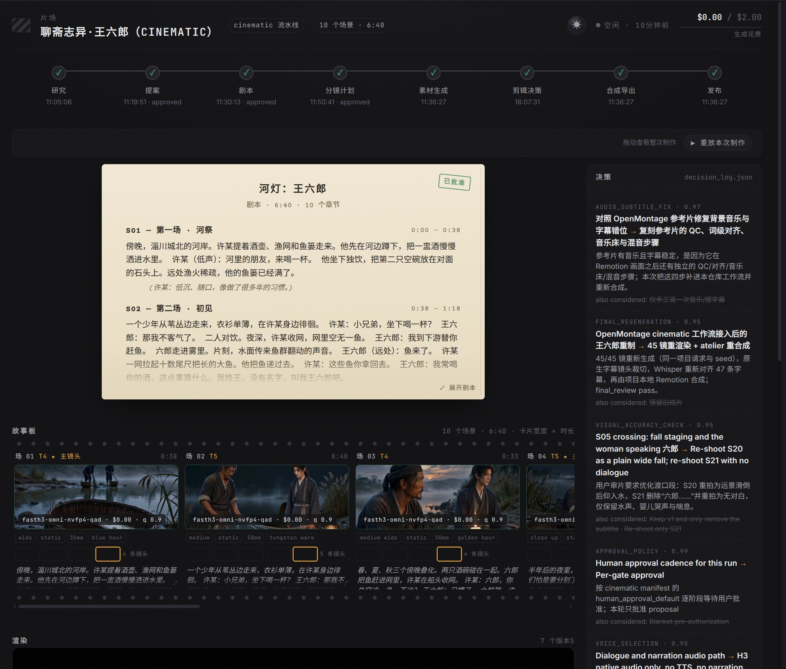
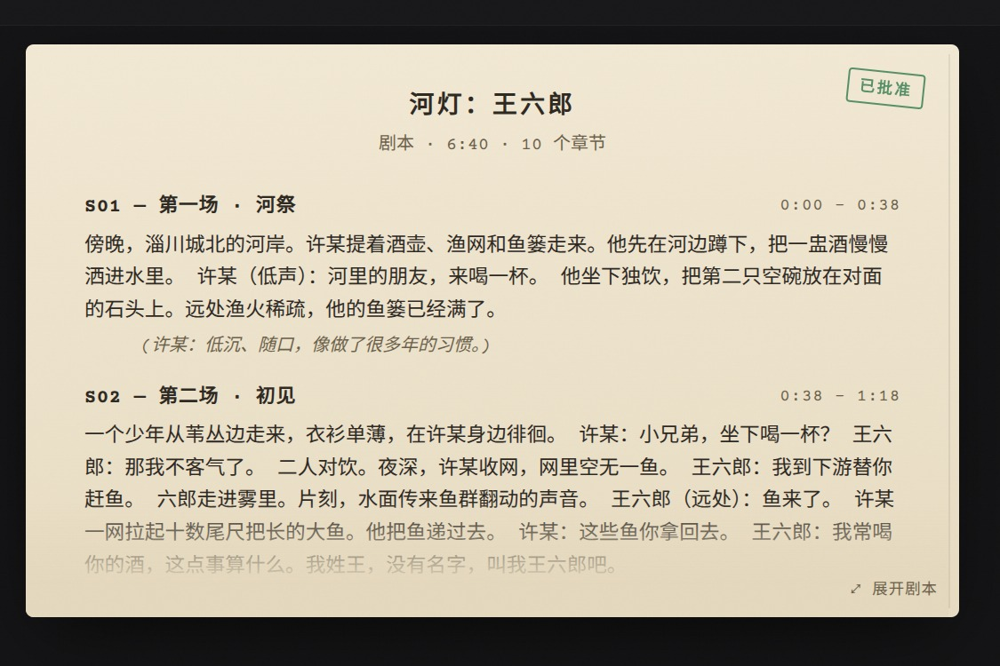

# novel-h3-studio

本地影视化制作仓库：**OpenMontage `cinematic` 工作流 + FastH3-Omni NVFP4 QAD 本地音画生成 + 中文 Backlot 制片看板**。

当前默认生产路径不是旧版 `novel-cinematic`，而是 OpenMontage 的 `cinematic` 流水线：

```text
research → proposal → script → scene_plan → assets → edit → compose → publish
```

每个阶段都有 checkpoint、正式产物和导演技能。工作流入口是 `studio.py`，阶段规范以
[`openmontage/AGENT_GUIDE.md`](openmontage/AGENT_GUIDE.md) 为准。

## 工作台

Backlot 中文制片看板直接读取 `projects/<id>/` 的阶段检查点、剧本、故事板、镜头版本与决策日志。



剧本审查视图：场次、台词归属与时间窗口。



## 当前项目

```text
projects/liaozhai-wangliulang-cinematic/
├── project.json                  # pipeline_type: cinematic
├── artifacts/                    # script / scene_plan / edit_decisions / render_report
├── assets/requests.json          # 45 个 FastH3 Ref2VA 请求（源数据）
├── assets/shots/                 # 每镜 native.mp4 + receipt + prompt
├── prompts/S01.txt ... S45.txt   # 可读的六段式提示词
├── public/
│   ├── props.json                # Remotion 时间线 / 字幕 / 片段
│   ├── shots/                    # Remotion 读取的镜头
│   └── fonts/                    # 毛笔字体
├── Composition.tsx / Root.tsx    # 项目本地 Remotion 合成
├── exports/wangliulang_final.mp4 # 成片
└── checkpoint_*.json             # 各阶段状态
```

参考资产在 `projects/liaozhai-wangliulang/assets/`：

```text
assets/refs/       # 许某、王六郎、妇人等身份参考
assets/scenes/     # 河岸、客栈、土地祠等场景参考
assets/voices/     # 角色声线 WAV
source/            # 原文
```

## 快速开始

### 环境

```bash
.venv-openmontage/bin/python studio.py doctor
```

### 初始化一个 cinematic 项目

```bash
.venv-openmontage/bin/python studio.py init my-film \
  --title "我的短片" --pipeline cinematic
```

### 启动中文看板

```bash
.venv-openmontage/bin/python studio.py serve --port 4751
# 浏览器打开 http://127.0.0.1:4751/
```

Backlot 默认中文；阶段、剧本、分镜、渲染、决策和检查点都从项目文件读取。

### 启动 FastH3 服务

```bash
runtime/fastvideo-venv/bin/python start_fastvideo.py \
  --project projects/liaozhai-wangliulang
```

服务监听 `127.0.0.1:8195`，输出 1344×768 / 24fps，带 H3 原生对白与音效。

### 按请求逐镜生成

`assets/requests.json` 是 cinematic 项目的镜头源；每项包含六段式 prompt、参考图/声线、
帧数、seed 和输出路径。

```bash
.venv-openmontage/bin/python scripts/render_cinematic_shots.py \
  --project projects/liaozhai-wangliulang-cinematic \
  --force --restart-every 1
```

脚本只做批量调度：实际生成由 OpenMontage 的 `fastvideo_h3_video` 工具完成。每次成功后
会同步 `assets/shots` 与 `public/shots`，并更新 `assets/take_manifest.json` 和 checkpoint。

### 镜头 QC、字幕对齐与剪辑

```bash
# 每镜 LUFS / 真峰值 / 对白转写 → artifacts/asset_qc.json
.venv-openmontage/bin/python scripts/qc_cinematic_shots.py \
  --project projects/liaozhai-wangliulang-cinematic

# Whisper 词级对齐 → artifacts/asr.json
.venv-dialogue/bin/python scripts/align_cinematic_dialogue.py \
  --project projects/liaozhai-wangliulang-cinematic

# 由 QC + ASR + edit_decisions 生成 props / edit_timing / subtitles.srt
.venv-openmontage/bin/python scripts/build_cinematic_edit.py \
  --project projects/liaozhai-wangliulang-cinematic

# 检测并裁切 H3 原生字幕镜头（只改 public/shots，保留 assets/shots）
.venv-dialogue/bin/python scripts/audit_cinematic_assets.py \
  --project projects/liaozhai-wangliulang-cinematic --crop
```

### 音乐床与混音

```bash
# 按 assets/music/cues.json 生成音乐床（-30 LUFS，4 个 cue）
.venv-openmontage/bin/python scripts/build_cinematic_music_bed.py \
  --project projects/liaozhai-wangliulang-cinematic
```

### 合成

Remotion atelier 只渲染画面 + H3 原生音轨，输出 `renders/wangliulang_picture.mp4`：

```bash
.venv-openmontage/bin/python studio.py tool video_compose @compose_picture_payload.json
```

然后把音乐床混入并重新封装：

```bash
# 提取原生音轨 → 每镜 gain → audio_mixer full_mix（ducking）→ alimiter 封装
.venv-openmontage/bin/python scripts/mix_cinematic_audio.py \
  --project projects/liaozhai-wangliulang-cinematic
```

最终文件是 `renders/wangliulang_final.mp4`，交付副本写到 `exports/wangliulang_final.mp4`。

### 最终校验

- `ffprobe`：1344×768 / 24fps / H.264 + AAC 192k
- `qc_cinematic_shots`：每镜 LUFS / 对白文本比
- `align_cinematic_dialogue`：Whisper 词级字幕对齐
- `subtitle_qc`：没有双层字幕；S12/S15/S25/S30 原生字幕已裁切
- `audio_mix_report`：音乐 bed、ducking、最终响度 / 真峰值
- `final_review`：画面、音频、字幕、runtime 合同

## 工作流原则

1. **源数据唯一。** cinematic 项目的 `assets/requests.json` 和 `prompts/S*.txt` 是镜头源；不要在
   version 脚本里另造一套 prompt。
2. **阶段化。** 按 OpenMontage cinematic 阶段推进，不跳 gated stage；每阶段写 checkpoint。
3. **原生音频。** 对白和现场音效来自 H3 原生音轨；音乐只做 bed，并在对白下 duck。
4. **项目本地合成。** 成片由项目自己的 Remotion composition 渲染；不要用通用 FFmpeg
   slideshow 替代。
5. **中文看板。** Backlot 是中文 observer/approval UI；新增标签保持中文。
6. **旧工作流已删除。** 旧的 `novel-cinematic` / anchor/chain/novel_h3 workflow 不再存在；
   不要从新代码里 import 它。

## 模型运行时

`novel_h3/` 只保留本地模型服务所需的模块：

```text
fastvideo.py          # FastVideo HTTP 配置/请求
project.py            # 路径、哈希、锁
safety.py             # 内存/功耗约束
previs.py / previs_render.py
transition_audit.py
ref2va.py
memory_guard.py
```

旧的分镜/锚帧/chain/连续性/合成脚本已移除。镜头级 prompt、参考和视频都由 cinematic
项目的 `assets/requests.json` 驱动。

## 备注

- `openmontage/` 是本仓库内的正式工作流代码；Backlot 中文 UI 在 `openmontage/backlot/ui/`。
- Remotion 需要 `openmontage/remotion-composer/node_modules`；本机已安装。
- 大文件（takes、renders、node_modules）不进入 Git。
- 生产数据和最终交付物在 `projects/` 下；不要写到仓库根目录。
