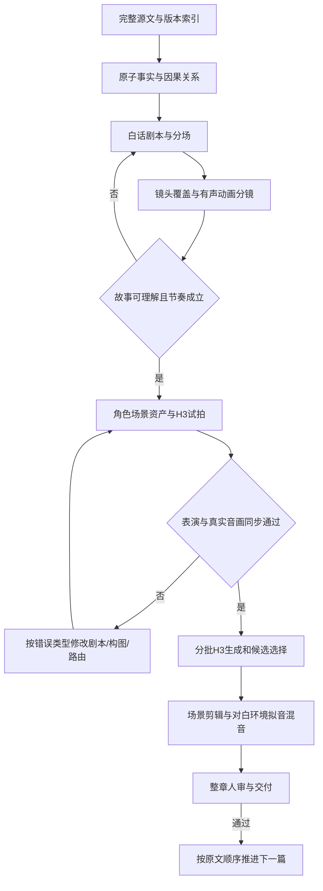

# 《聊斋志异》真人影视生产工作流 v2：审计与重构方案

本文件保留 2026-10-08 的审计与设计结论；当前实现和运行命令见[仓库 README](../../README.md)。项目审计素材保存在本机 `projects/`，不随 Git 发布。

日期：2026-10-08。范围：用户提供的全文、当前《考城隍》39 镜与审阅粗剪、当前仓库代码和本机 H3 路由。

**结论：有必要重构制片流程。优先改编、声音、模型输入编译、剪辑和验收；保留已经能运行的 MiniMax H3 推理底座。** 当前流程没有实现“好故事→可表演的戏→可剪辑素材→完整作品”的闭环。把现有问题逐一改成正面特写、增加禁止词或提升分辨率，无法解决这个结构性问题。

本轮交付为已取证的审计、实现设计和试拍剧本。没有声称 v2 已实现、样片已生成或品质已达标。检查时 ComfyUI running=0、pending=0，视频 worker 已退出；《耳中人》未恢复生成。所有旧素材作为比较基线保留。

## 1. 什么才算实现目标

- 以用户提供的文本为范围，按稳定篇 ID 和原文顺序制作。当前导入记录为 496 篇正文、1 篇前言，有 6 组同名篇；不把这个文件版本冒称为已经校勘的权威全集，不按标题去重。
- 每篇是可独立观看的真人风格短片。保留原作核心人物关系、事件因果、超自然规则、伦理命题与结局；时长随故事需要决定，长篇可按戏剧节点分集。
- 白话对白服务人物意图与对手反应。允许把原文间接引语改写为自然对白，允许有标注的生活动作和场面补足；不再要求文言对白逐字朗读，也不凭空增加重大事件。
- “完整”意味着原文完整保存、核心事实均有影视传达路径、删并转述有记录，不能简单等同于每段文字都配一条视频。
- 视频生成保持 MiniMax H3。新图资产遵守用户的 Codex 订阅 ChatGPT Images 2.5 要求；工具未给出实际模型时不得伪称已核验，也不自动切换付费 API。继续不加 BGM，但需要连续的环境声与拟音。
- 技术成功、叙事可理解、表演可信、人物一致、声音自然、真实音画同步、整片观感分别验收。单卡本地推理不应被承诺为无人审核即可稳定批量产出影视品质。

## 2. 已证实的根因

### 2.1 原文覆盖被误当作叙事完成

全书自动准备仍要求“人物对白逐字保留”“不能补写对白”“旁白不发声”，与白话戏剧改编目标冲突。《考城隍》已经有单章白话补丁，但全书规则没有一致修改。原文的自报姓名、问询消息等间接引语被压成无声动作，观众无法知道发生了什么。

当前 39 镜共 233.375 秒，11 镜有对白、28 镜没有对白；无对白镜头共 158.125 秒。脚本对白时窗仅 37.5 秒。最后一条字幕结束后还有约 103 秒影片，包含复生、张生死亡、九年奉母与赴任等关键事件。无对白本身不是缺陷，但当前没有足够可读的动作、文字或声音承担这些信息。

试题、善恶论和若干时间/事实提示还处于未制作状态。于是“为什么获选城隍”“死了多久”“为何九年后赴任”没有形成完整的观众因果链。34/39 个 scene_goal 只是 dramatic_function 的重复；source_fact_ids 实际只指向 2 个段落，不能代表原子事实已被传达。

定位：[preparation_worker.py:42](../../preparation_worker.py#L42)、[storyboard_design.py:18](../../novel_h3/storyboard_design.py#L18)、[arcreel.py:161](../../novel_h3/arcreel.py#L161)、内容计划:1701（本地 `projects/liaozhai-zhiyi/content_plans/chapter_s0002.json:1701`）。

### 2.2 为规避生成错误牺牲了表演和镜头关系

全部 11 个对白镜头都按 close-up 设计，32/39 镜标注 locked。比例本身不能证明作品差；实际联系表显示 S013/S014/S014B 是约 24 秒连续同构的宋焘正面特写。身体动作、对手反应、视点和场面变化被挤掉，剪切主要由对白任务拆分决定。

更严重的是，当前 S024 同时出现室内坐着的宋焘与棺内宋焘身体，却仍被标为 approved；S023 开头采样画面还有未登记背景人物。这些都在当前粗剪的 take 清单中，并非废弃旧片。

证据：当前人物与连续性联系表（本地 `projects/liaozhai-zhiyi/analysis/chapter_s0002_regenerated_audit/contact_25_30.jpg`）、连续特写联系表（本地 `projects/liaozhai-zhiyi/analysis/chapter_s0002_regenerated_audit/contact_13_18.jpg`）。本次查看的是联系表与指定画面，不把它表述成完整逐帧语义审片。

### 2.3 “口型通过”实际上没有检测嘴部

lip_sync_gate 只比较 VAD 首尾与计划对白窗口，容差 0.45 秒（24 fps 下约 11 帧）。它不读取嘴部画面、音素或说话人。配音先用 atempo 塞进预设窗口，再用同一窗口检查，只能证明时间安排基本自洽。

S013/S014/S014B 的实际模型输入同时要求嘴部表演和闭嘴。FL2VA 静音路径清空 dialogue 后触发无对白闭嘴模板，之后再贴 Qwen 配音。该流程没有建立语音与嘴型的条件关系。

定位：[audio_cleanup.py:262](../../novel_h3/audio_cleanup.py#L262)、[dialogue_dub.py:101](../../novel_h3/dialogue_dub.py#L101)、[director.py:315](../../novel_h3/director.py#L315)、实际 S013 提示（本地 `projects/liaozhai-zhiyi/renders/t_6239cc3163b4/prompt.json`）。此前将这个门称为口型验证是不准确的，应纠正。

### 2.4 音频生产链存在实际降质

用于 ASR 的 16 kHz 单声道代理被传入清理和增益函数，再写回生产视频。现场 ffprobe 确认 15/39 镜最终源音轨为 16 kHz，其中包含全部 11 个对白镜；其余 24 镜为 H3 原生 32 kHz。最后升到 48 kHz 不能恢复丢掉的频率和声场。

5 个对白镜记录为完全清空 H3 环境音后贴配音。其余激进中心频段清理也不是语音源分离，可能同时去掉动作声和房间声。逐镜整体 RMS 补增益与整条片段硬拼接没有建立场景声音连续性。

当前粗剪现场响度测量为 −16.0 LUFS、LRA 26.1 LU、true peak −0.7 dBFS。不能仅凭这些数字断言主观听感，但对白与环境音落差、原始立体声损失均需处理。本次没有主观试听。

定位：[audio_review.py:42](../../audio_review.py#L42)、[speech_qc.py:86](../../novel_h3/speech_qc.py#L86)、[audio_cleanup.py:203](../../novel_h3/audio_cleanup.py#L203)、原始响度结果（本地 `projects/liaozhai-zhiyi/analysis/workflow_v2_audit/ebur128_raw.txt`）。

### 2.5 模型输入是累积补丁，缺少一致的编译契约

实际 S013 prompt 为约 10,705 字符，S016 约 14,713 字符，混有重复 LOCK、资产登记信息、空间坐标与禁止词。更长不等于更准。模式转换后仍引用未输入的 Picture/Subject，说明制作数据与模型实际条件没有一一对应。

上一轮甚至通过匹配中文审片意见中的特定词组决定是否保留寿籍，措辞稍改就不生效。重拍必须成为结构化修改，例如 required_visible_props，而不是靠意见关键词改变摄像机。相同图作为首尾帧只能约束端点，不能证明人物表演自然。

### 2.6 缺少真正的剪辑层，验收状态还会失真

当前 concatenate 把完整生成片段顺序拼接，缺少 source in/out、反应切点、独立音轨、J/L cut 和场景底声跨镜延续。生成片段长度直接变成成片镜头长度，因此对白结束后常留下固定的 2–4.833 秒尾部。

普通镜头可凭技术 QC、ASR 和上述时间窗检查自动 approved；候选选择又倾向最新 take。部分重拍选择不重新对照完整创作依赖，迁移逻辑允许凭 schema 和对白复用旧片；计划改了但素材仍“当前”存在风险。拒绝重拍还会直接删除原 take 的 MP4，破坏 A/B 比较和回退。

定位：[media.py:116](../../novel_h3/media.py#L116)、[delivery_policy.py:34](../../novel_h3/delivery_policy.py#L34)、[comfy.py:1047](../../novel_h3/comfy.py#L1047)、[rework_queue.py:57](../../novel_h3/rework_queue.py#L57)。

## 3. 推荐工作流

### 第一道工序：读懂并改编

把原文拆为事实而不是机械切句：人物目标、阻力、选择、代价、转折、结果、伏笔、揭示点。每项保留 source span，并标注原文明示、合理推断、戏剧化补足或核心不可改。核心事实要指定 audience_delivery：具体动作、具体台词、准确文字或必要画外信息，并映射到最后时间线。

先写完整分场剧本：每场谁想得到什么、对方为什么不立即满足、观众新知道什么、场尾什么发生了变化。再写白话对白。允许间接引语转对白，禁止为了 ASR 好识别牺牲角色语气。旁白不是默认必需，也不应作为无法传达信息时仍然禁止使用的僵硬规则。

### 第二道工序：低成本验证整篇是否好看

用故事板和临时试读声音做完整 animatic，先调揭示顺序、表演停顿、情绪转折和时长。此时检查不读原文的观众能否理解因果。字幕/试卷题目/时间变化必须已出现在分镜时间线里，不能一直停留在待后期制作清单。

临时 TTS 只用于试读与节奏，不默认成为真人嘴部镜头的最终音轨。每场规划关系镜头、主观视点、表演覆盖、反应和必要插入镜头；镜别比例没有硬配额，每次切镜需有信息或情绪理由。

### 第三道工序：资产服务具体场面

全书共享整体摄影美术风格，每篇独立角色身份命名空间，避免《聊斋》不同故事串脸。人物先锁身份、年龄、服装与声线，再为关键场景制作同光位、同轴线的构图图。不要要求所有小道具都有昂贵多视图；核心道具、强交互或文字特写才单独建立资产。

演员外形、场景材质与灯光应统一。镜头关键帧首先要支持人物关系与行动。复杂调度才试 Blender；预演是参考，不是数值坐标会被模型严格执行的保证。生成画面不负责准确书写中文；试题、卷文和必要字幕在后期准确排版、跟踪合成。

### 第四道工序：MiniMax H3 生成可用表演

推荐默认采用 **H3 原生联合音画**，把角色、白话台词、意图、动作、参考声线作为同一个表演请求。Ref2VA 用于多模态参考；I2VA/FL2VA 用于明确的起止构图或动作，转换模式时重新编译资产标签与声音策略。Motion Context 只用于真正连续动作，切镜不强行继承旧潜变量。

制作数据保留复杂约束，但只向模型提交单一、清楚、无冲突的视听指令。Ref2VA 按六段、FL2VA 按三段编译，引用必须全部解析；闭嘴和说话冲突、引用缺失、无声输入却要求精确口型都应在提交前阻止。

生成区间使用已验证的运行时长度范围，编辑镜头可更短。官方标称单次 4–15 秒；本地节点允许某些更短帧数，并不证明短于这个范围有同等品质。需要短反应时可从带余量的候选剪出。官方公开 Base 与完整托管工作流也有区别，不能把本地放大写成官方 2K 再生成。[MiniMax 官方模型说明](https://huggingface.co/MiniMaxAI/MiniMax-H3)

严格定稿配音如果原生路线不稳定，再单独验证 H3 audio guide/音频条件路线；guide 的存在不等于已保证逐音素口型。普通声音参考与强制目标波形应在适配器中分开。未经试拍证明，禁止用“静默视频+独立TTS”作为同步兜底。[Comfy 原生 H3 指南](https://docs.comfy.org/tutorials/video/minimax/minimax-h3-native)

每条重要镜头先做少量候选，按表演与可剪接性选用，不自动拿最新版本替代最好版本。相同硬错误重复出现要回到剧本、构图或模式，不无限重拍。更多采样步、更高精度和超分只在清洁输入的对照试验后决定。

### 第五道工序：剪辑与声音重新统一

将 generated_clip 与 editorial_shot 分离。一段候选可以剪出多个使用段；同一场对白可跨反应镜头延续。EDL 保存 source_in/source_out、timeline_in、视频/音频轨与转场，不再拼完整生成文件。

音频分三条不可混用的路径：原始 H3 音画母版只读；制作混音保留高质量立体声和独立 stems；16 kHz mono 仅作 ASR/检测代理。任何混音变更后重新计算媒体哈希和 QC，字幕对齐锁定后的实际语音。禁止中心频带清零冒充源分离，也禁止把人工合成的通用噪声标成已同步拟音。

按场景持续设计房间底噪、呼吸、纸笔、衣物、马蹄、脚步与远近关系；没有 BGM 仍有完整声音世界。用对白响度、true peak、动态范围和整段试听控制混音，而不是每镜独立 RMS 拉满。

### 第六道工序：分层验收并按篇推进

状态必须独立：technical_qc、transcript_qc、speech_window_alignment、av_sync_review、visual_semantic_review、performance_review、sound_review、narrative_review、human_chapter_review。

真正的 AV 同步要使用可见说话人轨迹和嘴部画面，与音频对齐评估；脸或嘴不可见、检测器不适用时标 not_evaluated，不伪装通过。检测阈值用本项目人工标注的正负样本校准；模型分数是筛查依据，不取代主观听音和影视审片。

建议保留三个高价值人工节点：剧本/animatic、约一分钟完整戏、整篇成片；其余用自动筛查与例外队列降低重复点击。用户已授权的参考声音自动通过只适用于该范围，不自动扩张为最终电影验收。

全书采用滚动生产：当前一篇做制作，下一篇可在恢复授权后做文字准备，后续保持索引。不一次性准备数百篇图片、不在当前篇质量未过关时继续消耗 GPU。

## 4. 代码怎么重构

采用 Python 模块化单体、一个 GPU 调度器和现有 FFmpeg/ComfyUI。当前规模不需要微服务、分布式队列或同时重写所有前端。

保留：源文件无损导入与稳定 ID、已有资产及回执、H3/Comfy 启动与硬件保护、ffprobe/解码技术检查、已有工作台连接。可复用不等于沿用旧审批状态。

重建以下边界，先落在 `novel_h3/v2/`，旧项目只读迁移：

1. `source` / `adaptation`：SourceFact → Beat → DramaticScene；把戏剧场景从 15 秒模型片段约束中解放。
2. `planning`：EditorialShot 与场景连续性、表演意图、可见道具、观众信息映射；不靠自由文本关键词推断重拍策略。
3. `h3/compiler` / `h3/runner`：ProductionIR → 模式专属提示与真实节点图。提交前检验引用、声音、帧长、素材依赖；保存确切输入和版本。
4. `sound`：只读原始母带、分析代理、制作音轨分离。对白原声优先，所有修复有来源和回退。
5. `edit`：整数帧时间基、EDL、多轨声音、字幕与文字合成；候选的长度与电影剪辑长度分离。
6. `review`：按媒体/时间线哈希绑定多维证据。technical_pass 不能写成人工 approved；最新候选不能自动成为 chosen_take。
7. `jobs` / `store`：项目级 SQLite（WAL）事务存任务、版本、选择与审阅事件；大媒体只在文件系统保存。单 worker lease、幂等 submission ID、Comfy prompt ID 重连与中断恢复，避免重复提交和孤立 running 状态。

核心数据关系：`StoryRevision → ScriptRevision → ScenePlan → ShotPlan → GenerationRequest → Take → SelectedUse → EditTimeline → Mix → Review`。每条依赖内容哈希；改变台词、构图、声音或时间线只失效相应下游。旧 state.json 先归档，导入后保持既有素材可追溯，不删除项目、不覆盖旧视频。

拒绝候选只记录 reject 与原因，原件保留。垃圾回收是独立操作，不能绑定重拍按钮。审片意见结构化为 `wrong_identity / extra_subject / missing_prop / dialogue_error / av_desync / performance_flat / story_missing / continuity_break` 等明确原因，再决定回哪一层修正。

工作台最需要的改动是：按篇显示故事与阶段状态；分场剧本和有声分镜；带时间码的批注；A/B 候选对照；独立视听/叙事状态；可恢复任务日志。不要让“已生成 39/39”成为最突出的作品质量指标。

## 5. 分步落地与验收

**P0：先修会制造假通过或损坏素材的路径。** 移除自动 approved 的语义混用；把现有 lip_sync_gate 改为时间窗对齐；分离音频代理与母带；拒绝不删除媒体；阻止嘴动/闭嘴和缺引用的提示。验证要用真实立体声、高频与静音测试信号，确认分析前后母带 SHA 不变、音轨不会变为假立体声；用错口型样本确保“时间对了但嘴不对”不会自动通过。

**P1：重写《考城隍》完整分场与 animatic。** 必须让观众理解为何被选、为何请求延后、九年的根据、张生的安排、复生证据和结尾。剧作通过后再锁对白与镜头，不保留现有 39 镜作为不可改变的配额。[完整七场方案与试拍设计](../../docs/liaozhai-v2/kaochenghuang-pilot.md)

**P2：实现模式明确的编译器与 H3 小样。** 先保持权重和采样设置，比较清洁输入，再逐项试采样配置。六类难例、每类两种子，先消除确定缺陷后才研究量化与超分。新策略未证明之前不宣布某参数是质量解药。[H3 验证计划](../../docs/liaozhai-v2/h3-validation-plan.md)

**P3：剪辑、混音和验收贯通约一分钟戏。** 选择授职—奉母—查寿—代任，验证跨人物反应、关键道具、自然白话和声音空间。硬缺陷为换脸/复制人物、错词漏词、明显声画不同步、关键因果不可理解、无法衔接。软指标为表演、节奏、声音自然度，人工记录理由。这个样片过关才扩整章。

**P4：整章与规模化。** 重做完整《考城隍》，旧片只作 A/B 基线。通过人工审阅后按原文顺序推进；《耳中人》保持暂停，直到进入明确获准的下一篇制作阶段。每一篇复用流程与世界美术，不复用不相干的人物身份和剧情模板。

建议先设每个难镜 2 个候选，重复硬错误时返回上游、单镜最多 3 次尝试后进入例外队列；这是待试拍校准的预算策略，不是已经验证的阈值。以“最终被选且验收通过的秒数”为产出，计算 GPU 秒/合格秒、审核分钟/合格秒、重拍原因分布。没有样片实测前，不估计全书必定几天完成，也不以一次最快运行外推。

## 6. 本轮证据与边界

- 可复跑采集脚本（本地 `projects/liaozhai-zhiyi/analysis/workflow_v2_audit/collect_evidence.py`）
- 本次审计 JSON：媒体、源文件、输入图及代码哈希（本地 `projects/liaozhai-zhiyi/analysis/workflow_v2_audit/evidence.json`）
- 原始响度测量（本地 `projects/liaozhai-zhiyi/analysis/workflow_v2_audit/ebur128_raw.txt`）
- 旧粗剪：仅作为被用户否定的比较基线（本地 `projects/liaozhai-zhiyi/previews/chapter_s0002_54a5a660362e_rough_cut.mp4`）

本次核对了当前 take/粗剪引用与 SHA、逐镜 ffprobe、代码与实际模型 prompt，并查看当前联系表。5,601 帧完整解码是前次技术报告的事实，不能据此说每一帧人物、动作、情绪已语义验收；ASR 和 VAD 也不能据此说声音已被主观听过。新方案的质量提升必须由新的完整戏和整章人审来证明。
